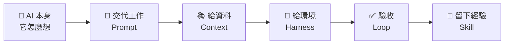
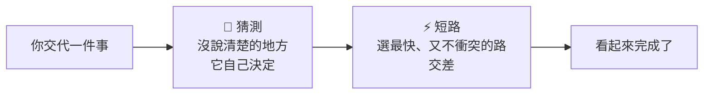
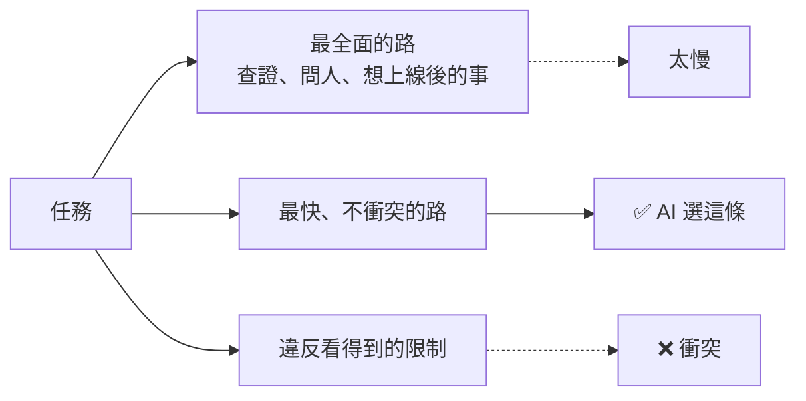
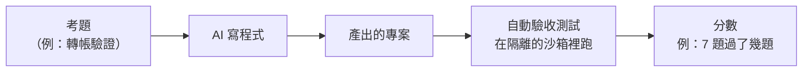

# 00　開場

<!-- 10 分鐘 -->

---

## 先看一段 AI 寫的設定

請 AI 寫一個使用公司框架 **CBMP** 的專案，它交出：

```xml
<groupId>com.cathaybk.cbmp</groupId>
<artifactId>cbmp-fabric-application-parent</artifactId>
<version>1.0.0</version>
```

看起來很專業，對吧？

**三行全是編的。** 這些名字在 CBMP 裡都不存在。

<!-- 讓大家看 5 秒，問「有人看得出哪裡錯嗎？」再揭曉。 -->

---

## 今天只回答一個問題

> **AI 不認識我們的東西，要怎麼讓它真的做對？**

答案**不是**「換一個更聰明的模型」。

而是像帶一位**新同事**一樣，一步一步給他東西：



---

## AI 的兩個習慣



| | 你以為 | 實際上 |
|---|---|---|
| 🎲 **猜測** | 我交代了一件事 | 它替你做了**十幾個**決定 |
| ⚡ **短路** | 它會選最好的做法 | 它選**最快能交差**的做法 |

接下來每看到 🎲 或 ⚡，就是它們又出現了。

---

## 🎲 猜測：你沒說的，它都替你決定了

| 你說 | 它得自己決定的事 |
|---|---|
| 「幫我寫一封請假信」| 請幾天？給誰？什麼原因？正式還是輕鬆？|
| 「把這份報告改好一點」| 「好」是指更短？更正式？還是更多數據？|
| 「做一份簡報」| 幾頁？給老闆還是給客戶看？要不要圖？|
| 「訂一間會議室」| 幾個人？哪一天？要不要投影機？|

它**不會停下來問**，而是每一題都選一個「最常見」的答案，直接做下去。

---

## ⚡ 短路：最快、不衝突，就交差

| 你說 | 最快、又不衝突的做法 | 你其實想要的 |
|---|---|---|
| 「讓這個測試通過」| 把測試**改掉**或**刪掉** | 把程式修好 |
| 「整理一下桌面」| 全部丟進同一個資料夾 | 照用途分類 |
| 「把這封信改短」| 砍掉日期和金額 | 留住重點、刪掉客套 |
| 「讓錯誤訊息不要再出現」| 把錯誤**藏起來**不顯示 | 找到原因、修好 |

每一個都**真的完成了你說的話**，但都不是你要的。

---

## ⚡ 短路理論

> AI 會**最先選擇「最快、而且不衝突」就能完成任務**的決定，
> 而不是**最全面**的決定。<br>
> 推論：**它看不到的限制，就不存在。**



<span>學界相近的概念：specification gaming、reward hacking、satisficing（Herbert Simon）。「短路理論」是講者實作後自己的歸納。</span>

<!-- 可以先講自己踩過的坑：寫正解時，自己也用了「測試會過」的捷徑（04 會講到）。 -->

---

## 我們怎麼證明「有沒有變好」？

工作坊裡，我們整天都用**同一份考題**、**同一把尺**：



- 每次只改一個條件，看**分數**和**花費**怎麼變
- 今天每段最後都有一頁「**工作坊實測**」，就是這些真實數據

> 💡 你不用懂程式，只要看「**幾分**」和「**花多少錢**」就好。（金額以 1 美元 ≈ 30 台幣換算）
