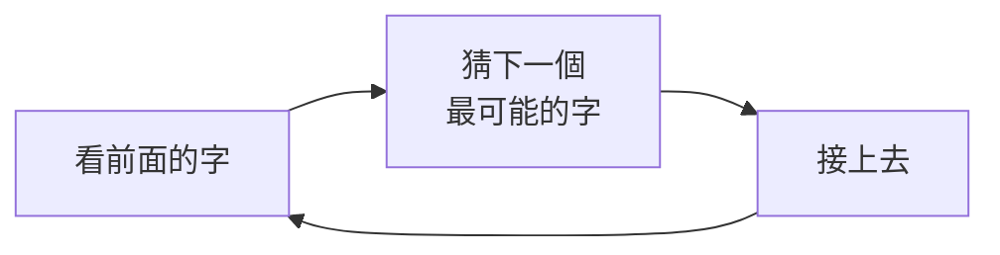
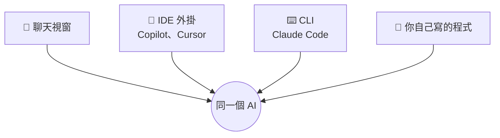
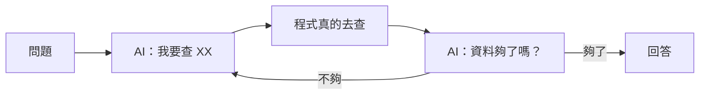
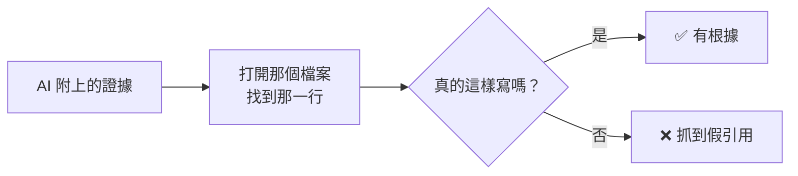
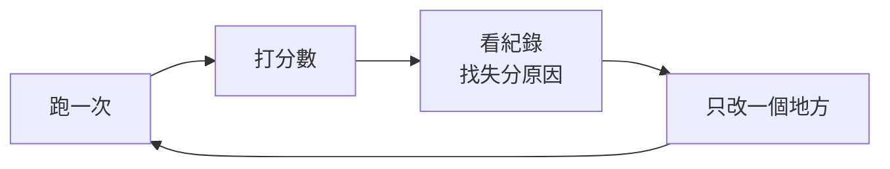

# 01　AI 到底在做什麼？

先認識它：為什麼會 🎲 猜、為什麼會 ⚡ 短路

<!-- 30 分鐘，含練習 1（5 分鐘） -->

---

## 解密 1：AI 其實只會「接龍」

🤔 **先猜猜看**，下一個字是什麼？

| 前面的字 | 最可能接 |
|---|---|
| 床前明月 | 光 |
| 今天天氣真 | 好 |
| 謝謝您的耐心 | 等待 |
| 我們公司福委會的分機是 | ？？？ |

前三題你接得很快。最後一題，**你會說「我不知道」**。

但 AI 會接一個**看起來很像分機號碼**的數字。

---

## AI 的接龍原理



- 它追求的是「**接得自然**」，不是「**接得正確**」
- 它沒看過的東西（你們公司的分機、內部系統），也會接得很自然

> 📌 **這就是「幻覺」（hallucination）的根源。**

---

## 🔬 工作坊實測：拼起來的假名字

我們用 CBMP 的 806 個程式檔，做了一個迷你接龍 AI，讓它寫類別名稱：

| 它寫的 | 存在嗎？ |
|---|---|
| `...orchestration.loop.LoopConfigurerImpl` | ✅ |
| `...starter.service.BatchJobService` | ❌ |
| `...batch.core.enums.BatchTriggerTypeEnum` | ❌ |

**8 個裡面有 5 個根本不存在。**
每一段字都真的出現過，**拼起來卻是假的**。你在審查時看得出來嗎？

<span>來源：traces/ch01/ex1_next_token.txt</span>

---

## 解密 2：AI 用「token」計價

token = AI 讀寫文字的單位。**長度上限、速度、價格，全都用它算。**

| 文字 | token 數 |
|---|---|
| 轉帳金額必須大於零（9 個中文字）| 11 |
| The transfer amount must be greater than zero | 8 |
| `ValidationUtils` | 2 |
| 驗證工具 | 5 |

- 中文：大約 **1 個字 = 1 個多 token**
- 一本 300 頁的手冊：大約 **20～30 萬 token**

<span>來源：traces/ch01/ex2_tokens.txt</span>

---

## 解密 3：AI 根本不記得你

你可能遇過：

| 情況 | 發生了什麼 |
|---|---|
| 開新視窗問「我剛剛說了什麼？」| 它不知道 |
| 聊了很久之後，它忘了你一開始的要求 | 前面的內容被淹沒了 |
| 每次換一個對話，都要重新自我介紹 | 每個對話都是全新的 |

那為什麼在同一個對話裡，它好像記得？

---

## 「記憶」是外面那層程式做出來的

你在聊天視窗打了兩句話，聊天程式實際送給 AI 的是：

<div class="grid grid-cols-2 gap-6">
<div>

**第 1 次送出**

```
[System] 你是樂於助人的助理
[Human]  我叫小明
```

AI 回：你好，小明

</div>
<div>

**第 2 次送出**

```
[System] 你是樂於助人的助理
[Human]  我叫小明
[AI]     你好，小明
[Human]  我叫什麼？
```

AI 回：你叫小明

</div>
</div>

AI 每次都是**第一次見到你**。是聊天程式把前面的對話，**原封不動地再送一次**。

---

## 第 2 次，真正送出去的是什麼？

| 角色 | 內容 | 這一則 |
|---|---|---|
| **System**（系統）| 你是樂於助人的助理，請用繁體中文回答 | 每一次都送 |
| **Human**（你）| 我叫小明 | 🔁 重送 |
| **AI**（它）| 你好，小明 | 🔁 重送 |
| **Human**（你）| 我叫什麼？| 🆕 這次才新增 |

- **System**：你看不到，但每次都在最前面，是 AI 的「工作守則」
- **Human / AI**：你和它的對話，**一則一則照原樣**排下去

🔬 **工作坊實測**：開新對話問代號 → 「不知道」（送出 466 token）；接續原對話 → 答得出來（523 token）。
**多出來的 57 token，就是被重送的對話。**

<span>來源：traces/ch01/ex3_stateless.txt</span>

> 📌 **對話越長，每一輪就越貴、越慢。**

---

## 💬 那為什麼問「我是誰」，它答得出來？

在終端機打 `claude -p "我是誰？"`，它說得出你的 **email** 和**使用者名稱**。它不是不記得你嗎？

🔬 問它「你從哪裡知道的？」：

| | 送出的 token | 它知道 | 它說的來源 |
|---|---|---|---|
| 預設設定 | 20,251 | email、使用者名稱、作業系統 | System 裡的帳號資訊、工作目錄路徑 |
| 隔離設定（關掉設定檔、工具，System 換成一句話）| 523 | email、使用者名稱、專案名稱 | 一樣 |

- AI 本身**不認識你**，是 Claude CLI 在送出前，**自動把你的資料附進 System**
- 就算把 System 換掉，CLI 還是會附上一小段，**你看不到，但它在**

> 📌 AI 知道的每一件事，都是**外面那層程式**放進去的。（04 Harness 會再講）

<span>來源：01-ai-basics/demo/traces/whoami_default.txt、whoami_isolated.txt（各為單次執行，email 已遮蔽）</span>

---

## 🤔 有沒有想過？AI 也可以這樣呼叫

你平常用 AI 的方式：



前三種，都是**別人寫好的程式**在幫你呼叫 AI。

第四種：**你自己寫程式呼叫它**。不用打開任何視窗，也不用一句一句貼。

---

## 一行指令就能呼叫

在終端機（Terminal）輸入：

```bash
claude -p "用一句話介紹你自己"
```

加上 `--output-format json`，連「帳單」一起拿回來（整理後）：

```
in=446  out=78  $0.0017  3.2s
```

送進 446 個 token、AI 寫了 78 個 token、花了約 0.05 元、3.2 秒。

> 💡 不需要 API key：用的是你已經登入的 Claude。
> 你按下 IDE 裡的按鈕時，背後做的事情其實差不多。

<span>來源：traces/ch01/llm_main.txt</span>

---

## 🐍 用 Python 呼叫 AI

```python
import subprocess

def ask(prompt):
    cmd = ["claude", "-p", prompt]
    return subprocess.run(cmd, capture_output=True, text=True).stdout

print(ask("用一句話介紹你自己"))
```

- 就是在 Python 裡，幫你打上一頁那行指令
- `ask()` 是今天所有東西的起點：**送出文字，拿回文字**
- 接下來的每一步，都只是在決定「**送什麼**」和「**拿回來之後做什麼**」

---

## 能用程式呼叫之後，可以做什麼？

| 用法 | 例子 |
|---|---|
| **批次** | 100 封客戶來信，一封一封自動分類 |
| **排程** | 每天早上 9 點，整理昨天的錯誤紀錄寄給你 |
| **串流程** | 收到表單 → AI 寫摘要 → 自動寄給主管 |
| **比較** | 同一題問 3 種模型，看誰答得好又便宜 |

```python
from pathlib import Path

for mail in Path("inbox").glob("*.txt"):
    kind = ask("這封信是：詢價／客訴／其他？只回一個詞。\n\n" + mail.read_text())
    print(mail.name, kind)
```

💡 今天看到的**所有工作坊實測**，都是這樣用程式呼叫、自動跑出來的。

---

## 🐍 「記憶」其實是一個 list

```python
messages = [{"role": "system", "content": "你是樂於助人的助理，請用繁體中文回答"}]

def chat(text):
    messages.append({"role": "human", "content": text})
    prompt = "\n".join(f"[{m['role']}] {m['content']}" for m in messages)
    reply = ask(prompt)                  # 每次都把「全部」送出去
    messages.append({"role": "ai", "content": reply})
    return reply

chat("我叫小明")
chat("我叫什麼？")    # 答得出來，因為上一句被重送了
```

- 和前面那張表一模一樣：**System 在最前面，Human / AI 一則一則排下去**
- 把 `messages` 清空，它就「失憶」了

<span>（正式的 API 裡，human / ai 分別叫 user / assistant）</span>

---

## 解密 4：AI 怎麼「動手」？

🤔 問 AI 這些問題，它要怎麼回答？

| 問題 | 只靠接龍 | 需要的工具 |
|---|---|---|
| 現在幾點？| 只能猜 | 看時鐘 |
| 今天台北會下雨嗎？| 只能猜 | 上網查 |
| 這個資料夾有幾個檔案？| 只能猜 | 列出檔案 |
| 這段程式跑得起來嗎？| 只能猜 | 執行它 |

AI 本身**只會寫文字**。要動手，得靠外面的程式幫它做。

---

## 智能體（Agent）= AI ＋ 迴圈 ＋ 工具



- AI 只負責「**說要做什麼**」
- 外面的程式才「**真的去做**」，再把結果交回給 AI
- 你在 Claude Code 按下 Enter 後，這個圈可能轉了 **7 次**

---

## 🐍 智能體的核心，十幾行就寫得完

```python
def agent(question, max_steps=8):
    notes = ""
    for step in range(max_steps):
        left = max_steps - step
        reply = ask(f"{question}\n目前查到：{notes}\n你還剩 {left} 步。"
                    "要讀檔就回 READ 檔名；資料夠了就回 ANSWER 答案")
        if reply.startswith("ANSWER"):
            return reply
        if reply.startswith("READ"):
            filename = reply.split()[1]
            notes += open(filename).read()   # 真正「動手」的是我們的程式
    return "步數用完，沒有作答"
```

AI 只回一段文字說它想做什麼，`open()` 是**我們的程式**執行的。

---

## 🔬 工作坊實測 ①：考題與評分

我們用這個迴圈，讓 AI 去公司框架的原始碼裡查一題：

> 「要自訂一個錯誤碼，應該實作哪一個介面？需要實作哪些方法？」

講師先準備好**標準答案**，拆成 5 個重點：

| | 標準答案的重點 | | 標準答案的重點 |
|---|---|---|---|
| 1 | 介面名稱 `DynamicSeverityCodeResolver` | 4 | 要實作 `category()` |
| 2 | 完整的套件路徑 | 5 | `severity()` 有預設值，可以不寫 |
| 3 | 要實作 `code()` | | |

**評分**：AI 的答案裡提到幾個重點，就得幾分。全提到 = **5/5**。

---

## 🔬 工作坊實測 ②：什麼是「證據」？

但平常工作，**很少有標準答案**。所以我們再加一條規定：

> 每個結論都要附上「**檔案:行號: 那一行的原文**」

```
BusinessException.java:20: public BusinessException(DynamicSeverityCodeResolver ...
Code.java:30: CODE code();
```

然後**用程式打開那個檔案、看那一行**，核對是不是真的這樣寫：



我們故意餵它一條錯的：`Code.java:30: String getCode();` → **❌ 第 30 行實際是 `CODE code();`**

---

## 兩種分數，量的東西不一樣

| | 對答案（事實比對）| 查證據（證據核對）|
|---|---|---|
| 需要標準答案嗎 | **需要** | **不需要** |
| 量的是 | 答得**完不完整** | 說的**有沒有根據** |
| 平常工作能用嗎 | 很少有標準答案 | **隨時都能用** |

🔬 自製迴圈有一次的成績：**證據 6/6，但答案只有 3/5**
→ 它說的每一句都是真的，只是**漏了兩個方法沒查到**。

> 📌 證據告訴你「它說的對不對」，但不會告訴你「它漏了什麼」。兩種要一起看。

---

## 🔬 工作坊實測 ③：怎麼從 0 分改到滿分？



| 版本 | 改了什麼 | 分數 | 看紀錄發現的問題（下一版要修的）|
|---|---|---|---|
| 1 | — | **0/5** | 查得很仔細，但**步數用完還沒回答** |
| 2 | 告訴它「你還剩幾步」 | 3/5 | 搜尋失敗只回「找不到」，它**猜錯原因**、白費兩步 |
| 3 | 出錯時把**原因講清楚** | **5/5** | — |

**AI 完全沒換**，只改了迴圈的兩個小地方。

<span>來源：traces/ch02/agent_out_of_steps.txt、agent_budget_no_hint.txt、agent_v3_clear_errors.txt（各為單次執行）</span>

---

## 🔬 工作坊實測 ④：用同一把尺比較模型

| 模型 | 答案 | 證據 | 花費 | 時間 |
|---|---|---|---|---|
| 小（haiku）| 4/5 | 10/10 | 2.1 元 | 43 秒 |
| 中（sonnet）| 5/5 | 15/15 | 2.3 元 | 24 秒 |
| 大（opus）| 5/5 | 22/22 | 5.7 元 | 40 秒 |

- **58 條證據，沒有一條是假的**：有工具查、又要附證據，它就不亂編
- 小模型**不一定比較快**：每步快，但要多走很多步

> 📌 讓 AI 不亂編，不是換更聰明的模型，而是**讓它查得到資料，並要它拿出證據**。

<span>來源：traces/ch02/ex4_evaluate_models.txt（單次執行）</span>

---

## ✍️ 練習 1：找出唬爛（5 分鐘）

有人問 AI：「**我們公司的請假系統 LeaveHub，要怎麼用 API 送出假單？直接給答案就好。**」

AI 很快回答：

```
1. 呼叫 POST https://leavehub.company.com/api/v2/leave
2. 在 Header 放入 X-LeaveHub-Token
3. 內容填 { "type": "annual", "days": 2 }
4. 成功後會回傳 leaveId
```

**請回答：**

1. 這 4 行裡，哪幾行是真的？
2. 它哪裡應該說「我不知道」？
3. 換成你，要怎麼問才不會被唬？

---

## 📝 練習 1 參考答案

1. **全部都是編的。** LeaveHub 是我們虛構的系統，AI 不可能知道它的網址和格式。
   但每一行都「**很像真的**」，這就是接龍的結果。
2. 第一行就該說了。但我們說了「**直接給答案**」，它就用最像的內容把空白填滿。
3. 比較好的問法：
   - 把**真的文件**一起給它（03 會講）
   - 加一句：「**不知道就說不知道，每一句都附上出處**」（就是剛剛的「證據」）
   - 不要說「直接給答案」，允許它先問問題

> 💡 會後可以拿你們**真實的內部系統名稱**問一般的 AI 聊天，看看它會不會老實說不知道。
