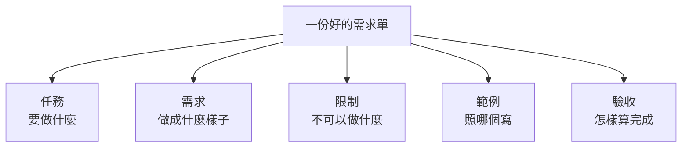

# 02　怎麼交代工作？（Prompt）

🎲 防猜測：把要求寫出來

<!-- 30 分鐘，含練習 2（10 分鐘） -->

---

## 同一句話，每個人要的都不一樣

| 你說 | A 想要的 | B 想要的 |
|---|---|---|
| 「翻譯成英文」| 給美國客戶看，口語一點 | 給主管看，保留專有名詞 |
| 「寫一個 Excel 公式算總和」| 加總 B 欄 | 只加總「已付款」的列 |
| 「幫我寫請假信」| 給主管，請 1 天病假 | 給 HR，請 5 天特休 |
| 「把報告改好一點」| 縮成一頁 | 加上更多數據 |

人會**問**，AI 會**猜**。🎲

而且它猜的，通常是「**最常見**」的答案，不是「**你的**」答案。

---

## 最便宜的檢查：先叫它列問題

動手前，先加一句：

```
幫我寫請假信

先不要寫。請列出你需要問我的問題。
```

🔬 AI 列出了 **14 個問題**（節錄）：

```
- 收件人是誰？（主管、老師、人資，還是其他人）
- 請假的種類？（事假、病假、特休、公假、喪假等）
- 請假的起訖日期與時段？（全天還是半天，幾點到幾點）
- 是否需要請假期間的代理人或交接安排？
- 正式程度：非常正式、一般正式，還是口語一點？
```

**如果你沒叫它問，這 14 題它會全部自己猜。** 🎲

<span>來源：02-prompt/demo/traces/leave_letter_questions.txt（haiku 5.5，單次執行）</span>

---

## 好的需求單有五個元素



把 AI 當成**第一天報到的新同事**來寫。剛剛那 14 個問題，就是五個元素裡缺的東西。

---

## 案例：請假信

**之前**：「幫我寫請假信」

**之後**：

| 元素 | 內容 | 回答了哪幾個問題 |
|---|---|---|
| 任務 | 寫一封請假信 | |
| 需求 | 給直屬主管；10/24（五）請特休 1 天 | 原因、日期、給誰、天數 |
| 限制 | 100 字內；語氣正式但不要太客套；用繁體中文 | 語氣 |
| 範例 | 「主旨：10/24 特休申請」這種格式 | |
| 驗收 | 要寫出**代理人**和**緊急聯絡方式** | 交接 |

「驗收」最常被漏掉，但它決定了**怎樣才算寫完**。

---

## 你的 prompt 送出去，長什麼樣子？

還記得 01 的 System / Human 嗎？你寫的需求單，會被放在 **Human** 裡，**照原樣**送出去：

```
[System]  （Claude Code 的工作守則，約 6,500 token，你看不到）

[Human]
<任務>寫一封請假信</任務>
<需求>給直屬主管；10/24（五）請特休 1 天</需求>
<限制>100 字內；語氣正式但不要太客套；用繁體中文</限制>
<範例>主旨：10/24 特休申請</範例>
<驗收>要寫出代理人和緊急聯絡方式</驗收>
```

- 用**標籤**把元素分開，AI 比較不會把「範例」誤當成「需求」
- System 是工具寫好的守則；**Human 才是你能控制的部分**

---

## 💬 沒寫的限制，它就自己決定

做這份投影片的示範時，我們請 AI 寫一封客服回信，
**忘了寫「用繁體中文」**。結果：

```
王先生您好，
感谢您的耐心等待。您的订单 A1024 延迟出货，我们诚挚道歉……
```

**整封信變成簡體字。** 加上一句「用繁體中文」，再跑就正常了。

> 🎲 沒說要繁體，簡體也「不衝突」，它就用了。<br>
> 對你來說**理所當然**的事，就是最該寫進「限制」的事。

<span>來源：03-context/demo/traces/context_demo_run1_no_lang.txt</span>

---

## 怎麼把 prompt 變成程式？四個步驟


以請假信為例，**第 ① 步**：

| 每次都一樣（寫成模板）| 每次都不同（變成參數）|
|---|---|
| 任務：寫一封請假信 | 日期 |
| 限制：100 字內、正式但不客套、繁體中文 | 假別（特休、病假……）|
| 範例：「主旨：日期 假別申請」| 天數 |
| 驗收：要有代理人和緊急聯絡方式 | 代理人是誰 |

---

## 🐍 第 ② 步：挖空，一樣的寫死、不同的變參數

```python
def leave_letter(date, kind, days, deputy):
    return f"""
<任務>寫一封請假信</任務>
<需求>給直屬主管；{date} 請{kind} {days} 天</需求>
<限制>100 字內；語氣正式但不要太客套；用繁體中文</限制>
<範例>主旨：{date} {kind}申請</範例>
<驗收>要寫出代理人（{deputy}）和緊急聯絡方式</驗收>
"""

print(ask(leave_letter("10/24", "特休", 1, "小華")))
print(ask(leave_letter("11/3", "病假", 2, "阿美")))
```

- `{date}`、`{kind}` 這些大括號，就是**挖空的地方**
- 下次請假，只要改括號裡的四個值，**不用重寫整段**

---

## 🐍 第 ③ 步：照五個欄位組裝，順便檢查有沒有漏

```python
FIELDS = ["任務", "需求", "限制", "範例", "驗收"]

def build_prompt(spec):
    missing = [f for f in FIELDS if not spec.get(f)]
    if missing:
        print("⚠️ 還沒寫：", missing)           # 忘了寫驗收，一眼就看出來
    return "\n".join(f"<{f}>{spec[f]}</{f}>" for f in FIELDS if spec.get(f))

prompt = build_prompt({
    "任務": "幫我挑 3 家餐廳候選",
    "需求": "12 人；週三晚上 6:30；每人 600 元內；要包廂",
    "限制": "2 位吃素；不要燒烤；用繁體中文",
})
# ⚠️ 還沒寫： ['範例', '驗收']
```

不管什麼任務，都用**同一個組裝函式**，五個元素就不會漏。

---

## 🐍 第 ④ 步：執行、記錄，一次比較 5 種寫法

```python
ladder = {
    "P0": {"任務": task},
    "P1": {"任務": task, "需求": req},
    "P2": {"任務": task, "需求": req, "限制": rules},
    "P3": {"任務": task, "需求": req, "限制": rules, "範例": examples},
    "P4": {"任務": task, "需求": req, "限制": rules, "範例": examples, "驗收": check},
}

for name, spec in ladder.items():
    answer = ask(build_prompt(spec))
    score  = run_acceptance(answer)              # 用同一把尺打分數
    print(name, score)
    open(f"results/{name}.txt", "w").write(answer)   # 存下來，事後才查得到原因
```

- **每一階只多一個元素**，其他全部不變。分數變了，就知道是哪個元素的功勞
- 結果**存成檔案**：下一段實測裡「打開 P2 的答案，查它為什麼只拿 2 分」，靠的就是這一行

---

## 🔬 實測 ①：一個迷你的「公司框架」

我們在 `02-prompt/demo/` 做了一個小專案。先有一個**公司框架**，規定錯誤一律用這兩個類別：

```python
# company_errors.py（AI 沒看過這個檔案，就像它沒看過 CBMP）
class ValidationError(Exception):
    def __init__(self, field): ...      # 參數只有一個：欄位名稱
class BusinessError(Exception):
    def __init__(self, code): ...       # 參數只有一個：錯誤碼
```

**考題**：寫一個 `validate_transfer()`，檢查轉帳請求：

| 情況 | 要拋出 |
|---|---|
| 帳號空白、金額 ≤ 0 | `ValidationError("欄位名稱")` |
| 轉出轉入相同 | `BusinessError("T00001")` |
| 金額大於餘額 | `BusinessError("T00002")` |

AI **不能讀檔、不能跑程式**，只看得到我們給的 prompt。

---

## 🔬 實測 ②：怎麼打分數？

AI 交件後，程式把**講師的 7 個測試**放進去執行（每次都重新覆蓋，AI 改不到）：

| | 測試 | | 測試 |
|---|---|---|---|
| 1 | 正常請求可以通過 | 5 | 帳號相同 → `T00001` |
| 2 | 轉出帳號空白 → 欄位 `from_account` | 6 | 餘額不足 → `T00002` |
| 3 | 轉入帳號空白 → 欄位 `to_account` | 7 | 金額剛好等於餘額 → 可以通過 |
| 4 | 金額 ≤ 0 → 欄位 `amount` | | |

**過幾個就得幾分**，滿分 7/7。

> 再加一個**測試沒有測的上線檢查**：前端**漏傳金額**（`None`）時，應該拋出公司的 `ValidationError`，而**不是讓程式當掉**。

<span>程式：02-prompt/demo/acceptance_test.py、grade.py；講師正解 reference/transfer.py 可以拿到 7/7 而且上線可用</span>

---

## 🔬 實測 ③：先叫它列問題

`python3 02-prompt/demo/ex1_questions.py`

| | prompt 長度 | AI 想問的問題 |
|---|---|---|
| P0 只有任務 | 32 字 | **13 個** |
| P4 五個元素都有 | 759 字 | **7 個** |

P0 問的（節錄）：要哪些欄位？金額規則？失敗時怎麼回傳？要不要檢查餘額？

P4 剩下的問題（節錄 3 個）：

```
- 只包含空白字元的字串（例如 "   "）是否也算空白，需要拋出 ValidationError？
- 若 balance 是 None，要拋出哪個錯誤？還是視為餘額為 0 來做業務檢查？
- 若 amount 或 balance 是非數字型別（例如字串 "100"），要拋出 ValidationError 還是嘗試轉型？
```

**寫清楚之後，剩下的才是真正值得討論的問題。**

<span>來源：02-prompt/demo/traces/ex1_questions.txt（haiku 5.5，單次執行）</span>

---

## 🔬 實測 ④：每一階加了什麼？

| 階 | 加了什麼 | 實際寫的內容（節錄）|
|---|---|---|
| P0 | 任務 | 寫一個 Python 函式，驗證轉帳請求 |
| P1 | + 需求 | 檔名、函式名稱、5 條驗證規則、錯誤碼 |
| P2 | + 限制 | 錯誤類別在 `company_errors` 模組，**不可以自己定義**；只回傳程式碼 |
| P3 | + 範例 | `raise ValidationError("email")`、`raise BusinessError("A00003")` |
| P4 | + 驗收 | 會跑哪 7 個測試；完成前**自我檢查**：漏傳欄位（None）也要拋 ValidationError |

**AI、考題、評分都不變**，只改 prompt。每一階跑 **3 次**，因為單次結果會騙人。

`python3 02-prompt/demo/ex2_ladder.py`（15 次 haiku 5.5，約 3 分鐘）

<span>prompt 全文：02-prompt/demo/prompts.py</span>

---

## 🔬 實測 ⑤：結果揭曉

| 階 | 新增 | 3 次的分數 | 全對 | 上線可用 | 平均花費 |
|---|---|---|---|---|---|
| P0 | — | 0, 0, 0 | 0/3 | 0/3 | 0.04 元 |
| P1 | 需求 | 0, 2, 0 | 0/3 | 0/3 | 0.03 元 |
| P2 | 限制 | 2, 2, 2 | 0/3 | 0/3 | 0.02 元 |
| P3 | 範例 | 7, 7, 7 | **3/3** | 0/3 | 0.01 元 |
| P4 | 驗收 | 7, 7, 7 | **3/3** | **3/3** | 0.02 元 |

<span>來源：02-prompt/demo/traces/ex2_ladder.txt（haiku，各 3 次）；每次產生的程式在 02-prompt/demo/runs/ex2_ladder/</span>

---

## 打開來看：每一階它猜了什麼？

| 階 | 打開 `runs/ex2_ladder/` 看到的 | 為什麼 |
|---|---|---|
| P0 | 函式叫 `validate_transfer_request`；3 次都**自己加了幣別檢查**；寫了 93～132 行 | 🎲 名字、範圍全靠猜 |
| P1 | 名字對了，錯誤類別 3 次 3 種猜法：用不存在的 `FieldValidationError`、自己寫一個、猜模組叫 `company.errors` | 🎲 不知道公司有框架 |
| P2 | 知道要用 `company_errors`，但寫成 `ValidationError("amount", "金額必須大於 0")`，公司的只收**一個**參數 → 當掉 | 🎲 知道在哪，不知道怎麼用 |
| P3 | 照範例寫 `ValidationError("amount")` → 全對，程式**最短**（15～19 行）| 範例指路，不用自己摸索 |

> 📌 分數不如預期時，**打開來看**。每一個失分，背後都是一個它**猜錯的地方**。

---

## 🔬 實測 ⑥：通過測試 ≠ 真的能上線

P3 3 次都 7/7，但前端**漏傳金額**時：

```
P3（3 次全部）：TypeError: '<=' not supported between 'NoneType' and 'int'   ← 程式當掉
P4（3 次全部）：ValidationError: amount                                       ← 正確擋下
```

P4 只多了驗收裡那一句：

> 「完成前請自我檢查：前端可能漏傳欄位（值是 None），這時也要拋出 ValidationError，不能讓程式當掉」

> ⚡ **短路**：7 個測試都過，是最快的交差方式；「漏傳欄位」測試沒測，它看不到，就不存在。<br>
> 📌 把踩過的坑寫進驗收清單。但 prompt 只能傳遞「**你已經知道的事**」。

---

## ✍️ 練習 2：一句話的需求單（10 分鐘）

主管說：「**幫我安排下週的部門聚餐。**」

1. 如果直接丟給 AI，它會**自己猜**哪些事？至少寫 5 個
2. 用五個元素重寫：**任務、需求、限制、範例、驗收**
3. （有電腦的話）貼給任何 AI，加一句：

```
先不要做。請列出你還需要問我的問題。
```

**目標**：AI 的問題少於 3 個。

---

## 📝 練習 2 參考答案

**它會自己猜的**：日期、人數、預算、地點、要不要包廂、有沒有人吃素、誰付錢、最後要交出什麼

**重寫後**：

| 元素 | 內容 |
|---|---|
| 任務 | 幫我挑 **3 家**餐廳候選，我再決定 |
| 需求 | 12 人；下週三或四晚上 6:30；捷運站步行 10 分鐘內；每人 600 元內；要包廂 |
| 限制 | 2 位吃素、1 位不吃牛；不要燒烤；Google 評分 4.0 以上 |
| 範例 | 上次大家很喜歡的那種「合菜、可以邊吃邊聊」的店 |
| 驗收 | 用表格列出店名、地址、每人預估、有無素食、訂位電話，**每家附上資料來源** |
