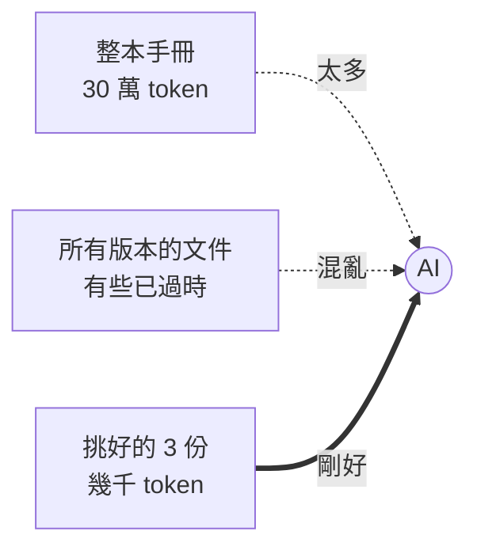
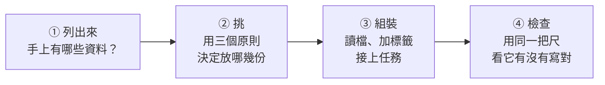

# 03　該給它看什麼？（Context）

🎲 防猜測：讓它看到對的資料

<!-- 30 分鐘，含練習 3（5 分鐘）＋ 現場示範（python3 03-context/demo/context_demo.py 1，約 1 分鐘、6 次 haiku 5.5；投影片的數據是每種 3 次） -->

---

## 沒給資料，它就只能猜

| 你問 | 沒給它的資料 | 它只好…… |
|---|---|---|
| 「我們年假有幾天？」| 員工手冊 | 用勞基法的一般規定回答 |
| 「這週的會改到哪間會議室？」| 改期通知信 | 留一個「【會議室】」空格給你填 |
| 「這個錯誤要怎麼修？」| 錯誤訊息 | 列出 10 種「常見原因」 |
| 「照公司格式寫週報」| 週報範本 | 自己發明一種格式 |

AI 的「**視野**」（context）= 它這一次**看得到的所有文字**。
看不到的，對它來說就不存在。

---

## 你給的資料，送出去長什麼樣子？

和 02 的需求單一樣，資料也是**照原樣**接在 Human 裡，排在任務前面：

```
[System]  你是一位客服人員，請用繁體中文回答。

[Human]
<資料 名稱="customer_email.txt">
寄件人：王先生
主旨：我的訂單怎麼還沒到？

你好，我 4/8 下單的訂單 A1024（藍牙耳機），網站說 4/10 會出貨，
今天都 4/14 了還沒收到出貨通知。請問到底什麼時候會到？會有補償嗎？
</資料>

<資料 名稱="reply_template_2025.txt">
【客服回信範本　2025 年版（現行）】
出貨延遲超過 3 天時：
1. 先向客戶道歉
2. 說明延遲原因與新的預計出貨日
3. 補償：提供免運券一張（購物金方案已於 2023 年停止，請勿再提供）
4. 結尾留下客服專線 0800-000-000
</資料>
（抱怨信後面還有訂單紀錄、範本後面還有物流公告，格式一樣）

請以客服身分回覆王先生，說明訂單為什麼延遲、什麼時候出貨、我們提供什麼補償。用繁體中文，100 字以內。
```

---

## 從這份原文看到什麼？

- **沒有任何魔法**：AI 不會自己去翻公司的檔案，**你貼什麼，它就看什麼**
- 每份資料用 `<資料>` 標籤包起來，它比較分得出「這是抱怨信」、「這是範本」
- 標籤上的「名稱」也會被它讀到，所以**檔名本身就是線索**（`reply_template_2025.txt` 的 2025）
- 資料放前面、任務放最後：讀完資料，最後才看到要做什麼

<span>完整原文：python3 03-context/demo/context_demo.py --show ⑥（只印出來，不呼叫 AI）</span>

---

## Context 是一張工作桌



- 桌上的每一樣東西，**每一輪都要重新付錢**（01 的「記憶」）
- 桌子太滿，**重點會被淹沒**

---

## 放資料的三個原則

| 原則 | 反例 | 會發生什麼 |
|---|---|---|
| **小而準** | 問一個報帳問題，丟整本 300 頁手冊 | 又貴又慢，還可能抓錯段落 |
| **新不舊** | 給了 2019 年版的請假規定 | 照舊規定回答，頂多提醒你「請確認」|
| **標清楚** | 新舊兩份檔案都叫「範本.docx」| 它分不出該聽哪一份 |

> 📌 **AI 就算懷疑你給的資料，也還是照著寫。** 你給什麼，它就用什麼。

---

## 怎麼建一個 Context？四個步驟



| 步驟 | 誰來做 | 難在哪 |
|---|---|---|
| ① 列出來 | 人 | 要知道公司**有哪些**資料 |
| ② 挑 | 人（**最重要**）| 要知道哪份是**新的、對的** |
| ③ 組裝 | 程式（10 行）| 不難 |
| ④ 檢查 | 程式 | 要先想清楚「寫對」是什麼 |

第 ② 步就是接下來的練習。

---

## ✍️ 練習 3：哪些資料該放上桌？（5 分鐘）

任務：請 AI **回覆一位客戶，說明他的訂單為什麼延遲出貨**。

你手上有這些資料，**挑出要給 AI 的**：

| | 資料 | | 資料 |
|---|---|---|---|
| A | 客戶寄來的抱怨信 | E | 今年最新的客服回信範本 |
| B | 這張訂單的出貨紀錄 | F | 過去一年所有客服信件（5 萬封）|
| C | 公司全部 300 頁的員工手冊 | G | 物流公司本週的延誤公告 |
| D | 2019 年版的客服回信範本 | H | 尾牙活動照片 |

**加分題**：哪一份資料放進去，反而會**害它寫錯**？

---

## 📝 練習 3 參考答案

**要給的：A、B、E、G**（小而準）

| 不給的 | 原因 |
|---|---|
| **D 舊範本** | ⚠️ **最危險**：裡面可能是舊的補償規定，AI 分不出哪份是新的 |
| C 員工手冊、F 5 萬封信 | 太大：又貴又慢，重點被淹沒 |
| H 尾牙照片 | 無關 |

接下來，我們**真的跑一次**，看看挑錯會怎樣。

---

## 🐍 第 ③ 步：組裝，就是「讀檔、加標籤、接在一起」

```python
def build_context(files):
    parts = []
    for path in files:
        text = path.read_text(encoding="utf-8")
        parts.append(f'<資料 名稱="{path.name}">\n{text}\n</資料>')
    return "\n\n".join(parts)

TASK = ("請以客服身分回覆王先生，說明訂單為什麼延遲、什麼時候出貨、"
        "我們提供什麼補償。用繁體中文，100 字以內。")

files = [DOCS / "customer_email.txt", DOCS / "order_A1024.txt",
         DOCS / "reply_template_2025.txt", DOCS / "logistics_notice.txt"]
reply, cost = ask(build_context(files) + "\n\n" + TASK)
```

- 程式只負責組裝；**決定 `files` 裡放什麼，才是 Context 工程**
- `ask()` 和 02 一樣，用隔離設定，**不給工具**：AI 只能看我們放上桌的東西

<span>完整程式：03-context/demo/context_demo.py</span>

---

## 🐍 第 ④ 步：檢查，先想清楚「寫對」是什麼

客服主管說，這封信**一定要做到 4 件事**：

```python
def check(reply):
    return {
        "出貨日 4/17": "4/17" in reply or "4 月 17" in reply or "4月17" in reply,
        "給免運券":    "免運券" in reply,
        "沒給購物金":  "購物金" not in reply,     # 已經停止的方案
        "留客服專線":  "0800-000-000" in reply,
    }
```

- 每一項都是**程式能判斷**的事（02 的「驗收」）
- 「語氣好不好」這種事程式判斷不了，**留給人看**，所以每封信都存在 `runs/context_demo/`

---

## 🔬 實測 ①：6 份資料，6 種桌面

| `03-context/demo/docs/` | 練習 3 的 | 內容 |
|---|---|---|
| `customer_email.txt` | A | 王先生：訂單 A1024 怎麼還沒到？會有補償嗎？|
| `order_A1024.txt` | B | 倉庫缺貨，4/16 補貨，4/17 出貨 |
| `reply_template_2019.txt` | D | 舊範本：補償 **100 元購物金** |
| `reply_template_2025.txt` | E | 現行範本：補償**免運券**（購物金已停止）、留客服專線 |
| `logistics_notice.txt` | G | 本週北部宅配延遲 1 天 |
| `year_end_party.txt` | H | 尾牙通知（無關）|

另外把 D、E **拿掉年份和「現行」**，改名成 `範本.txt`、`範本(1).txt`，用來測「標清楚」。

同一個任務，**只改桌上放哪些資料**，每種桌面跑 3 次。

---

## 🔬 實測 ②：結果揭曉

`python3 03-context/demo/context_demo.py`

| 桌上放了 | 分數（滿分 4）| 它做了什麼 |
|---|---|---|
| ① 什麼都不給 | 1, 1, 1 | 3 次都留【出貨日期】這種**空格** |
| ② 不給＋「不要反問」| 1, 1, 1 | 一樣留空格；**第 3 次連提醒都沒有** |
| ③ 舊範本 D | 1, 1, 1 | 3 次都送 **100 元購物金**，附註「請確認」|
| ④ 新舊都給，沒標清楚 | 3, 3, 3 | 選了新的，附註「兩份不一樣」|
| ⑤ 全部丟進去 | 4, 4, 4 | 範本寫著「現行」，直接寫對 |
| ⑥ 挑對的 A、B、E、G | **4, 4, 4** | ✅ |

<span>①②③ 的 1 分，只是因為沒提到購物金。18 次共約 0.3 元。來源：03-context/demo/traces/context_demo.txt</span>

---

## 打開來看：沒資料時，它寫了什麼？

① 第 2 次：

```
我目前沒有這筆訂單的資料，以下是可直接套用的回覆範本，請填入實際內容後再發送：

王先生您好，非常抱歉讓您久等。您的訂單因【延遲原因】而延後，預計將於【出貨日期】出貨。
為表歉意，我們將提供【補償方案】。如有任何問題，歡迎隨時與我們聯繫。
```

- 它很老實：**不知道的就空著**。但這封信不能寄，資料還是得你去找
- ② 第 3 次只有信、**沒有任何提醒**。如果程式直接把它寄出去，王先生會收到「因[延遲原因]而延誤」

> 🎲 它沒有編，但也沒有幫上忙：**不知道的事，它變不出來**。

---

## 打開來看：給了資料，為什麼還會錯？

**③ 舊範本**：它發現是舊的，但還是照抄——

```
我們將全額退還運費，並贈送100元購物金作為補償。……
（備註：補償方案取自2019年版範本，寄出前請確認目前仍適用。）
```

> ⚡ 照抄桌上的範本最快，也不衝突；它把「確認」丟回給你。

**④ 兩份都叫「範本」**：3 次都選對了，但它自己也不確定——

```
（註：兩份範本的補償方式不同，「範本(1)」為免運券，「範本」為全額退運費加 100 元購物金。
以上採用「範本(1)」，若應以另一份為準，請告知，我再修改。）
```

- 3 分不是信寫錯：是附註提到「購物金」，被 `check()` 扣分。**程式打分也會看錯，所以要打開來看**

---

## 從這 6 種桌面學到什麼

| 原則 | 證據 |
|---|---|
| 沒資料就寫不出來 | ①②：6 封都只能留空格，有 1 封連提醒都沒有 |
| **新不舊** | ③：它看出是 2019 年版，3 次都提醒你確認，信裡還是寫 100 元購物金 |
| **標清楚** | ④ 對 ⑤：沒標時它要用猜的、還要你確認；標了「現行」，直接寫對 |
| **小而準** | ⑥：4 份就全對；⑤ 這次也全對，但那是**靠標示救回來**的 |

- 這個示範的檔案都很小，所以 ⑤ 沒有變貴，也沒有被淹沒

> 📌 **AI 的回答，最多只能和你給它的資料一樣好。**<br>
> 文件會過時，所以**文件當線索，程式碼（或系統裡的真實資料）當證據**。
