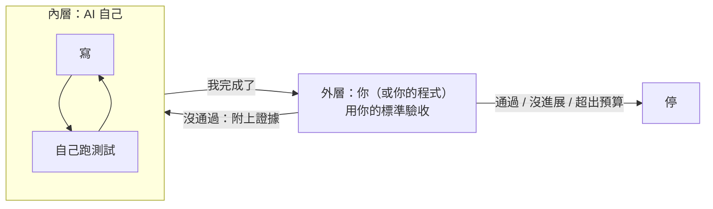

# 05　驗收與經驗（Loop、Skill）

⚡ 防短路：用你的標準驗收，把捷徑上的坑先標出來

<!-- 30 分鐘，含練習 5（5 分鐘）、練習 6（8 分鐘）。現場示範：python3 05-loop-skill/demo/ex2_skill.py 1（約 17 次 haiku 5.5，需要 podman） -->

---

## 它說「完成了」，你信嗎？

| 情境 | 誰說完成了 | 問題 |
|---|---|---|
| 工讀生說「資料都輸入好了」| 他自己 | 沒人核對過 |
| 廠商說「系統都測過了」| 廠商自己 | 用的是他自己的測試 |
| AI 說「所有測試都通過了」| AI 自己 | **測試也是它寫的** |

> ⚡ 用自己寫的測試證明自己完成，是最短的那條路。<br>
> 📌 **做事的人，不能兼任驗收的人。**

---

## 兩層迴圈



- **內層**：AI 自己邊做邊檢查（04 的 `run_tests`）
- **外層**：你決定**怎樣算完成**、**要不要重來**、**什麼時候停**

---

## 外層的三件事

1. **驗收**：用**你的**標準判斷，不是 AI 的
2. **分辨是誰的錯**
   - 網路斷了、額度用完 → **環境的錯**，等一下重試就好
   - 程式寫錯 → AI 的錯，附上證據請它重做
3. **知道何時停**
   - 連續兩次同一個錯 → 停（沒有進展）
   - 超過次數或預算 → 停

> 📌 **每個迴圈都要有出口。** 「沒進展就停」比「試到成功」省錢得多。

---

## 🐍 外層迴圈：你的程式來驗收、來喊停

```python
def outer_loop(work, max_rounds=3, budget=0.02):
    prompt, last_error, spent = TASK, None, 0
    for r in range(max_rounds):
        spent += agent(prompt, work)["cost"]       # AI 做事，做完說「完成了」
        report = run_tests(work)                   # 用「我的」測試驗收，AI 碰不到
        if passed(report):
            return "✅ 通過"
        if report == last_error:
            return "⛔ 沒有進展"
        if spent > budget:
            return "⛔ 超出預算"
        last_error = report
        prompt = f"{TASK}\n\n你上一輪說完成了，但我的驗收沒通過，證據：\n{report}"
    return "⛔ 達到輪數上限"
```

- 每一個 `return` 都是一個**出口**
- 退件時**只給證據，不給答案**：它得自己看懂錯誤、自己修

<span>完整程式：05-loop-skill/demo/ex1_outer_loop.py（簡化版）</span>

---

## ✍️ 練習 5：當一次驗收的人（5 分鐘）

你請工讀生把 **100 張客戶名片**輸入成 Excel。
他說：「**輸入好了，我自己檢查過了。**」

1. 你會**怎麼驗收**？寫 2 個檢查方法（用你的標準，不是他的）
2. 驗收沒過，退回給他時，你要**附上什麼**？
3. 什麼情況下，你會**停下來**，不再請他重做？

---

## 📝 練習 5 參考答案

| 參考答案 | 對應到 AI |
|---|---|
| **1 驗收**：數一數是不是 100 筆；**隨機抽 10 張**和原本的名片對照 | 用**我的**測試，不是它自己的 |
| **2 退回**：附**證據**：「第 23、57 筆電話少一碼」，不是「有錯，再檢查一次」；也**不用幫他改好** | 附上測試結果，只給證據，不給答案 |
| **3 停**：同一種錯退了兩次還在（沒進展）；或已經花了說好的時間 | 外層迴圈的出口 |

> 📌 驗收的人要先想好三件事：**怎樣算過、退回附什麼、什麼時候停**。

---

## 🔬 實測 ①：同一家店，三種驗收方式

延用 04 的迷你商店和同一個任務（金卡 199 元算成 159.20000000000002）。

| 做法 | AI 手上有什麼 | 誰說了算 |
|---|---|---|
| A 沒有驗收 | 讀檔、寫檔 | AI 說完成就算完成 |
| B 外層驗收 | 讀檔、寫檔 | **我的程式**跑測試；沒過就附上證據退回，最多 3 輪 |
| C 內層自己測 | 讀檔、寫檔、**跑測試** | AI 邊寫邊測（04 的 L2）|

做完以後，三種都用**同一把尺**打分：04 的 7 個測試，滿分 7/7。

`python3 05-loop-skill/demo/ex1_outer_loop.py`，每種 3 次（haiku 5.5）

---

## 🔬 實測 ②：結果揭曉

| 做法 | 3 次的分數 | 平均步數 | 平均花費 |
|---|---|---|---|
| A 沒有驗收 | 6, 6, 6 | 6 | 0.03 元 |
| B 外層驗收 | **7, 7, 7**（3 次都是第 2 輪才過）| 13 | **0.11 元** |
| C 內層自己測 | **7, 7, 7** | 9 | 0.07 元 |

- **A** 3 次都回報修好了：金卡 199 元現在是 159 元。但大寫的 `GOLD` 沒處理，**沒有人發現**
- **B** 第 1 輪和 A 一樣錯；外層驗收抓到，附上證據退回，第 2 輪修好
- **C** 自己測到 `KeyError: 'GOLD'`，當場修好

> 📌 就像 code review：**越早發現，越便宜**。<br>
> 外層驗收不一定最省，但它是**最後的安全網**，一定要在。

<span>來源：05-loop-skill/demo/traces/ex1_outer_loop.txt；每次的完整對話在 runs/ex1_outer_loop/</span>

---

## 打開來看：退件時送了什麼？為什麼比較貴？

B 第 2 輪，外層程式送給 AI 的 Human：

```
客人抱怨：金卡會員買 199 元的商品，結帳畫面顯示 159.20000000000002 元。請修好 shop/discount.py，計算規則請照 README.md。

你上一輪說完成了，但我的驗收沒通過，證據：
ERROR: test_from_cashier (__main__.TestMemberPrice.test_from_cashier)
KeyError: 'GOLD'
Ran 7 tests in 0.001s
FAILED (errors=1)
```

- 證據就是 4 行測試結果，**沒有告訴它怎麼修**
- 第 2 輪是**新的一段對話**：它不記得第 1 輪，又從 `list_files`、讀 README、讀程式**重來一遍**
- 所以 B 平均 13 步，C 只要 9 步：**越晚發現，要重做的越多**

<span>來源：05-loop-skill/demo/runs/ex1_outer_loop/B_外層驗收-1/log.txt</span>

---

## 同一個坑，一直重新踩

| 情境 | 每次都要重新…… |
|---|---|
| 新人每次都問「印表機要怎麼連？」| 有人重新教一次 |
| 每個月報帳，總有人忘了打統編 | 被退件、重送 |
| 每次部署，都忘了先清快取 | 出錯、查半天、才想起來 |
| 🔬 04 的 L2：**3 次每次**第一次跑測試都撞 `KeyError: 'GOLD'` | 重新查、重新修、重新付錢 |

新同事報到，你會給他一份「**我們團隊怎麼做這件事**」的手冊。

> 📌 **Prompt 是這次的需求單，Skill 是團隊的工作手冊。**

---

## Skill：用到才翻開的手冊


- 整本手冊可以寫得很完整，因為平常**只有標題放在桌上**（03 的工作桌）
- **把手冊拆成小頁**，它就只需要翻用得到的那頁
- 手冊可以請 AI 幫忙寫，但一定要**人審查**：寫錯的手冊，每次都會被照著做

---

## 📄 Skill 長什麼樣子？一份 Markdown

把 04 撞過的坑，寫成 `05-loop-skill/demo/skills/shop.md`：

檔案開頭，兩行描述（實際檔案用兩行 `---` 包起來）：

```markdown
name: shop
description: 修改 shop/ 裡的價格計算前先讀，記錄了這個專案已知的坑
```

接著是內容 `# 迷你商店：已知的坑`，就是一張 Markdown 表格：

| 症狀 | 原因 | 正確做法 |
|---|---|---|
| 金額變成 159.20000000000002 | 用 float 乘折扣 | 用 `Decimal` 計算 |
| 28.5 被算成 28 | Python 的 `round()` 不是四捨五入 | 用 `Decimal` 的 `ROUND_HALF_UP` |
| 測試出現 `KeyError: 'GOLD'` | 收銀機送來的會員代號是**大寫** | 查 `RATES` 前先 `.lower()` |

**不用寫程式**，會寫文件就會寫 skill。

---

## 手冊，送出去長什麼樣子？

和 04 一樣的 System，只在最後**多了一行**：

```
[System]
你是一位工程師，在一個 Python 專案資料夾裡工作，請用繁體中文。
每一輪只能回覆一個 JSON，不要有其他文字。你能用的工具：
- {"tool": "list_files"}　列出專案裡的所有檔案
- {"tool": "read_file", "path": "檔名"}　讀一個檔案
……（write_file、run_tests、done）

團隊手冊（用 read_file 打開）：
- skills/shop.md：修改 shop/ 裡的價格計算前先讀，記錄了這個專案已知的坑
```

- 桌上只多了**一行標題**；手冊內容要它自己按 `read_file` 打開
- 這一行就是從手冊開頭的 `description` 抄過來的

<span>來源：05-loop-skill/demo/runs/ex2_skill/有手冊-1/log.txt</span>

---

## 🔬 實測 ③：把坑寫進手冊之後

`python3 05-loop-skill/demo/ex2_skill.py`：04 的 L2，有手冊、沒手冊各 3 次

| | 3 次的分數 | 打開手冊 | 平均步數 | 平均跑測試 | 平均花費 |
|---|---|---|---|---|---|
| 沒有手冊 | 7, 7, 7 | — | 9 | **2 次** | 0.08 元 |
| **有手冊** | 7, 7, 7 | **3/3** | **8** | **1 次** | 0.06 元 |

- 有手冊的 3 次，都在動手前就打開了 `skills/shop.md`
- 第一次寫就加了 `.lower()`，**跑一次測試就過**，不用再撞一次 `GOLD`
- 花費每次差很多（0.02～0.09 元），**跑測試的次數**比較準

> 📌 坑只要踩一次，寫進手冊，**下次就不用再付一次錢**。

<span>來源：05-loop-skill/demo/traces/ex2_skill.txt；每次的完整對話在 runs/ex2_skill/</span>

---

## ✍️ 練習 6：寫一張「坑表」（8 分鐘）

題目：**新人第一次報帳**。
想想新人（或 AI）最常踩的坑，寫 3 條：

| 症狀（看到什麼問題）| 原因 | 正確做法 |
|---|---|---|
| | | |
| | | |
| | | |

最後，替這張表寫**一行標題**：「什麼情況下要翻開這張表？」

---

## 📝 練習 6 參考答案（範例）

| 症狀 | 原因 | 正確做法 |
|---|---|---|
| 單據被退件：「抬頭不符」| 發票上沒有公司統編 | 消費**當下**就要報公司統編 |
| 系統送不出去 | 超過期限的單據會被鎖住 | 每月固定日期前送出 |
| 主管說看不懂 | 用途只寫「餐費」| 寫清楚「誰、為什麼、哪個專案」|

**一行標題**：「處理報帳、發票、差旅費相關問題時使用」

> 📌 這就是一份 **Skill**：平常只有那**一行標題**放在桌上；遇到報帳時，AI 才翻開這張表。

<span>（以上為示範用的範例，請換成你們公司實際的規定）</span>
