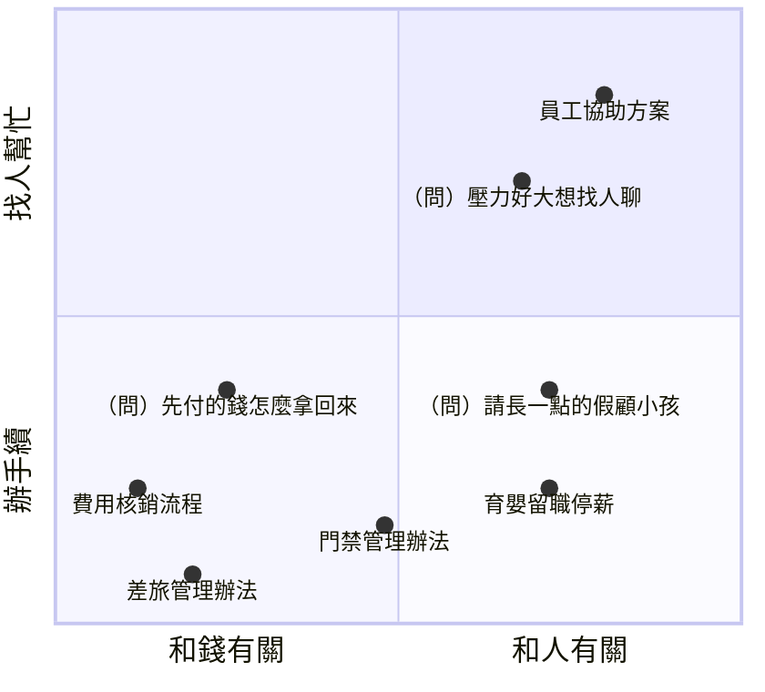
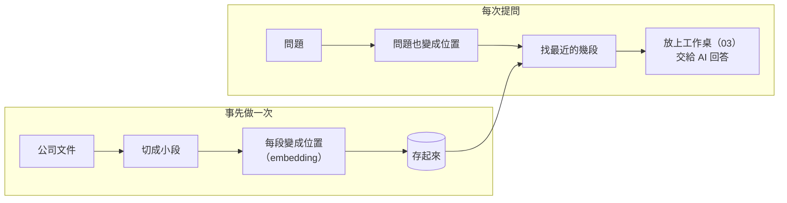
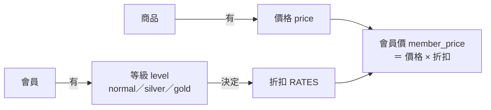
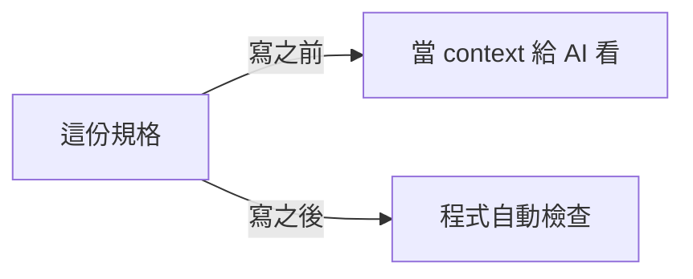
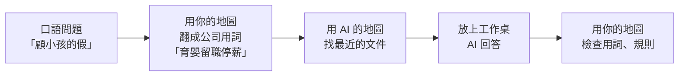

# 06　加場快閃：兩張地圖

Embedding、Ontology：🎲 防它猜錯你們的世界

<!-- 選講，約 10 分鐘，只講觀念；時間不夠就跳過 -->

---

## 兩張地圖

| | AI 的地圖（Embedding）| 你的地圖（Ontology）|
|---|---|---|
| 怎麼來的 | 從大量文字學來，**隱含**在模型裡 | 團隊**明確寫下來** |
| 知道什麼 | 一般的意思（**通用**）| **你們公司**的東西、叫法、關係 |
| 用來做什麼 | 用「意思」找資料（RAG）| 對齊概念、約束檢查、幫忙找資料 |

> 📌 AI 知道一般的「會員」是什麼，但不知道**你們的**會員。

---

## AI 的地圖：Embedding 把「意思」變成位置

<div class="grid grid-cols-2 gap-6 items-center">
<div>



</div>
<div>

每一段文字，都被放到一個**位置**上：**意思近的，放得近**。

- **好處**：問題和文件**一個字都不一樣**，意思近就找得到（連跨語言都行）
- **限制**：地圖是**通用**的：你們內部的叫法、只有名字沒有說明的東西，它放不準

<span>示意圖，不是實際數值；真正的位置有幾百個維度</span>

</div>
</div>

---

## RAG：先找，再答



- 找的方式：**關鍵字**（字一樣才找得到）、**語意**（意思近就找得到）
- 也可以不先找好，讓 AI 帶著工具**自己找**（04）：比較慢、比較貴，但找不到會再找

> 📌 RAG 的上限就是「**找**」：找錯了，AI 也只會在錯的資料上回答。

---

## 你的地圖：Ontology

**有哪些東西、有什麼屬性、彼此什麼關係、有哪些規則**，明確寫下來。用 04 的迷你商店：



軟體圈相近的說法：**領域模型**、DDD 的「**通用語言**」（Ubiquitous Language）。

---

## Ontology 的三個用法

| 用法 | 做什麼 | 例子 |
|---|---|---|
| ① 對齊概念 | 一個東西只用一個詞；不同的東西不混在一起 | 會員等級就叫 `level`；「客戶」和「會員」是不是同一件事？|
| ② 約束、檢查 | 關係和規則寫成結構，程式可以自動擋 | 退款沒有對應的原訂單 → 擋；折扣寫死 0.8 → 擋 |
| ③ 幫忙找資料 | 同義詞、相關概念，讓搜尋找得到 | 「顧小孩的假」→ 育嬰留職停薪 |

> 📌 名字錯了，只是不好讀；**關係錯了，會變成 bug**。

---

## 一份規格，兩種用法

```toml
[terms.level]
label     = "會員等級"
values    = ["normal", "silver", "gold"]
forbidden = ["tier", "membership", "customer_type"]
source    = "code"     # 從 shop/rates.py 整理

[rules.discount]
rule   = "折扣只能從 RATES 查，不可以寫死數字"
source = "team"        # 團隊決定
```



- 詞彙從**文件、程式碼、團隊決定**整理，每條寫明來源；文件會過時，不要只抄文件（03）
- **事先告訴，比事後擋下便宜**（05）；檢查還是要有，它是安全網

---

## 兩張地圖，合起來用



> 📌 **AI 的地圖負責「意思」，你的地圖負責「你們」。**
