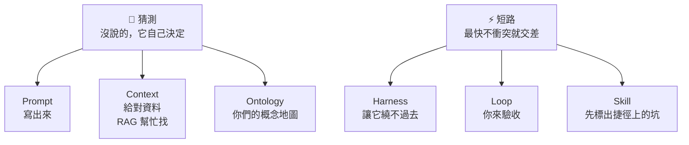

# 07　總結

---

## 一路走來：每一層都在防這兩件事

**AI 從頭到尾都沒換過。** 變的是我們給它的東西。

---

## 🔬 今天看到的證據

同一顆 AI（haiku 5.5），每次**只改一個地方**：

| 章 | 只改了什麼 | 結果 |
|---|---|---|
| 02 Prompt | 加上「範例」 | 2/7 → **7/7**；再加「驗收」，才**真的能上線** |
| 03 Context | 範本標上「現行」 | 要你確認、扣分 → **直接寫對** |
| 04 Harness | 給它 `run_tests` | 6/7 → **7/7** |
| 05 Loop | 外層驗收 | 6/7 **沒人發現** → 退件一次，**7/7** |
| 05 Skill | 寫一張坑表 | 跑測試 2 次 → **1 次** |

每一個數字，都可以在各章的 demo/ 自己重跑一次；紀錄在各章 demo/traces/

---

## 帶走三句話

1. **🎲 AI 猜得比你想像的多。**
   → 寫清楚、給對資料、寫下你們的概念地圖，要它附上證據。

2. **⚡ AI 會短路：最快、不衝突就交差。它看不到的限制，就不存在。**
   → 把限制寫成程式：工具、門鎖、沙箱、你的驗收。

3. **越早回饋、越早寫下經驗，就越便宜。**
   → 讓它自己測，你負責驗收，踩過的坑寫成手冊。

---
layout: section
---

# Q & A

謝謝大家
