<div class="hero-tags">
  <span class="tag guess">🎲 猜測</span>
  <span class="tag short">⚡ 短路</span>
</div>

# 同一顆 AI，<br>為什麼結果差這麼多？

不用會寫程式也聽得懂的 AI Coding 解密

<div class="hero-stat">
  <div><b>0/7</b><span>只給一句話</span></div>
  <div class="arrow">→</div>
  <div><b>7/7</b><span>只改我們給它的東西</span></div>
</div>

<div class="hero-foot">3 小時・6 個不用寫程式的小練習（附參考答案）</div>

<!--
講者備註：全場時間配置（180 分鐘）
0:00  00 開場                         10 分
0:10  01 AI 到底在做什麼               30 分（練習 1）
0:35  02 怎麼交代工作（Prompt）         30 分（練習 2）
1:05  休息                            10 分
1:15  03 該給它看什麼（Context）        30 分（練習 3 ＋ 現場示範）
1:45  04 給它什麼環境（Harness）        30 分（練習 4）
2:15  休息                            10 分
2:25  05 驗收與經驗（Loop、Skill）      30 分（練習 5、6）
2:55  07 總結與 Q&A                    5 分
06 加場快閃（兩張地圖：Embedding、Ontology）為選講，時間不夠就跳過。

🐍 頁是講解用的 Python 範例（簡化版），學員不用自己寫。
「🔬 實測」頁的數字，來自各章 demo/ 的實際執行（claude-haiku-5-5），紀錄在各章 demo/traces/。
01 的「工作坊實測」頁，來自原本 harness 工作坊的執行紀錄。
-->

---
layout: section
---

# 00　開場

<!-- 10 分鐘 -->

---

## 先看一段 AI 寫的設定

請 AI 寫一個使用公司框架 **CBMP** 的專案，它交出：

```xml
<groupId>com.cathaybk.cbmp</groupId>
<artifactId>cbmp-fabric-application-parent</artifactId>
<version>1.0.0</version>
```

看起來很專業，對吧？

**三行全是編的。** 這些名字在 CBMP 裡都不存在。

<!-- 讓大家看 5 秒，問「有人看得出哪裡錯嗎？」再揭曉。 -->

---

## 今天只回答一個問題

> **AI 不認識我們的東西，要怎麼讓它真的做對？**

答案**不是**「換一個更聰明的模型」。

而是像帶一位**新同事**一樣，一步一步給他東西：


---

## AI 的兩個習慣


| | 你以為 | 實際上 |
|---|---|---|
| 🎲 **猜測** | 我交代了一件事 | 它替你做了**十幾個**決定 |
| ⚡ **短路** | 它會選最好的做法 | 它選**最快能交差**的做法 |

接下來每看到 🎲 或 ⚡，就是它們又出現了。

---

## 🎲 猜測：你沒說的，它都替你決定了

| 你說 | 它得自己決定的事 |
|---|---|
| 「幫我寫一封請假信」| 請幾天？給誰？什麼原因？正式還是輕鬆？|
| 「把這份報告改好一點」| 「好」是指更短？更正式？還是更多數據？|
| 「做一份簡報」| 幾頁？給老闆還是給客戶看？要不要圖？|
| 「訂一間會議室」| 幾個人？哪一天？要不要投影機？|

它**不會停下來問**，而是每一題都選一個「最常見」的答案，直接做下去。

---

## ⚡ 短路：最快、不衝突，就交差

| 你說 | 最快、又不衝突的做法 | 你其實想要的 |
|---|---|---|
| 「讓這個測試通過」| 把測試**改掉**或**刪掉** | 把程式修好 |
| 「整理一下桌面」| 全部丟進同一個資料夾 | 照用途分類 |
| 「把這封信改短」| 砍掉日期和金額 | 留住重點、刪掉客套 |
| 「讓錯誤訊息不要再出現」| 把錯誤**藏起來**不顯示 | 找到原因、修好 |

每一個都**真的完成了你說的話**，但都不是你要的。

---

## ⚡ 短路理論

> AI 會**最先選擇「最快、而且不衝突」就能完成任務**的決定，
> 而不是**最全面**的決定。<br>
> 推論：**它看不到的限制，就不存在。**

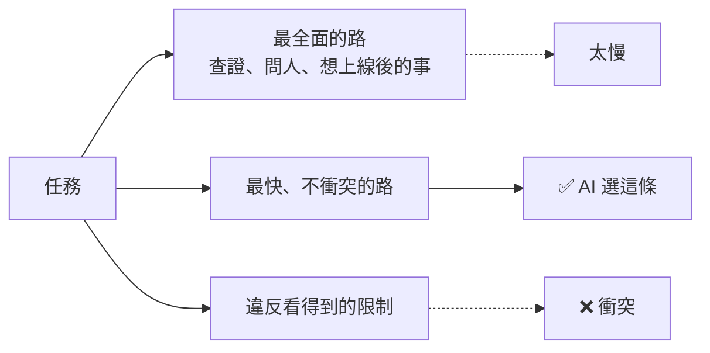

<span>學界相近的概念：specification gaming、reward hacking、satisficing（Herbert Simon）。「短路理論」是講者實作後自己的歸納。</span>

<!-- 可以先講自己踩過的坑：寫正解時，自己也用了「測試會過」的捷徑（04 會講到）。 -->

---

## 我們怎麼證明「有沒有變好」？

工作坊裡，我們整天都用**同一份考題**、**同一把尺**：


- 每次只改一個條件，看**分數**和**花費**怎麼變
- 今天每段最後都有一頁「**工作坊實測**」，就是這些真實數據

> 💡 你不用懂程式，只要看「**幾分**」和「**花多少錢**」就好。（金額以 1 美元 ≈ 30 台幣換算）

---
layout: section
---

# 01　AI 到底在做什麼？

先認識它：為什麼會 🎲 猜、為什麼會 ⚡ 短路

<!-- 30 分鐘，含練習 1（5 分鐘） -->

---

## 解密 1：AI 其實只會「接龍」

🤔 **先猜猜看**，下一個字是什麼？

| 前面的字 | 最可能接 |
|---|---|
| 床前明月 | 光 |
| 今天天氣真 | 好 |
| 謝謝您的耐心 | 等待 |
| 我們公司福委會的分機是 | ？？？ |

前三題你接得很快。最後一題，**你會說「我不知道」**。

但 AI 會接一個**看起來很像分機號碼**的數字。

---

## AI 的接龍原理

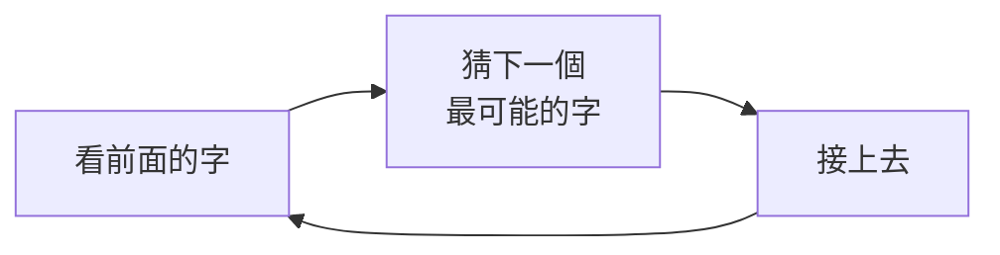

- 它追求的是「**接得自然**」，不是「**接得正確**」
- 它沒看過的東西（你們公司的分機、內部系統），也會接得很自然

> 📌 **這就是「幻覺」（hallucination）的根源。**

---

## 🔬 工作坊實測：拼起來的假名字

我們用 CBMP 的 806 個程式檔，做了一個迷你接龍 AI，讓它寫類別名稱：

| 它寫的 | 存在嗎？ |
|---|---|
| `...orchestration.loop.LoopConfigurerImpl` | ✅ |
| `...starter.service.BatchJobService` | ❌ |
| `...batch.core.enums.BatchTriggerTypeEnum` | ❌ |

**8 個裡面有 5 個根本不存在。**
每一段字都真的出現過，**拼起來卻是假的**。你在審查時看得出來嗎？

<span>來源：traces/ch01/ex1_next_token.txt</span>

---

## 解密 2：AI 用「token」計價

token = AI 讀寫文字的單位。**長度上限、速度、價格，全都用它算。**

| 文字 | token 數 |
|---|---|
| 轉帳金額必須大於零（9 個中文字）| 11 |
| The transfer amount must be greater than zero | 8 |
| `ValidationUtils` | 2 |
| 驗證工具 | 5 |

- 中文：大約 **1 個字 = 1 個多 token**
- 一本 300 頁的手冊：大約 **20～30 萬 token**

<span>來源：traces/ch01/ex2_tokens.txt</span>

---

## 解密 3：AI 根本不記得你

你可能遇過：

| 情況 | 發生了什麼 |
|---|---|
| 開新視窗問「我剛剛說了什麼？」| 它不知道 |
| 聊了很久之後，它忘了你一開始的要求 | 前面的內容被淹沒了 |
| 每次換一個對話，都要重新自我介紹 | 每個對話都是全新的 |

那為什麼在同一個對話裡，它好像記得？

---

## 「記憶」是外面那層程式做出來的

你在聊天視窗打了兩句話，聊天程式實際送給 AI 的是：

<div class="grid grid-cols-2 gap-6">
<div>

**第 1 次送出**

```
[System] 你是樂於助人的助理
[Human]  我叫小明
```

AI 回：你好，小明

</div>
<div>

**第 2 次送出**

```
[System] 你是樂於助人的助理
[Human]  我叫小明
[AI]     你好，小明
[Human]  我叫什麼？
```

AI 回：你叫小明

</div>
</div>

AI 每次都是**第一次見到你**。是聊天程式把前面的對話，**原封不動地再送一次**。

---

## 第 2 次，真正送出去的是什麼？

| 角色 | 內容 | 這一則 |
|---|---|---|
| **System**（系統）| 你是樂於助人的助理，請用繁體中文回答 | 每一次都送 |
| **Human**（你）| 我叫小明 | 🔁 重送 |
| **AI**（它）| 你好，小明 | 🔁 重送 |
| **Human**（你）| 我叫什麼？| 🆕 這次才新增 |

- **System**：你看不到，但每次都在最前面，是 AI 的「工作守則」
- **Human / AI**：你和它的對話，**一則一則照原樣**排下去

🔬 **工作坊實測**：開新對話問代號 → 「不知道」（送出 466 token）；接續原對話 → 答得出來（523 token）。
**多出來的 57 token，就是被重送的對話。**

<span>來源：traces/ch01/ex3_stateless.txt</span>

> 📌 **對話越長，每一輪就越貴、越慢。**

---

## 💬 那為什麼問「我是誰」，它答得出來？

在終端機打 `claude -p "我是誰？"`，它說得出你的 **email** 和**使用者名稱**。它不是不記得你嗎？

🔬 問它「你從哪裡知道的？」：

| | 送出的 token | 它知道 | 它說的來源 |
|---|---|---|---|
| 預設設定 | 20,251 | email、使用者名稱、作業系統 | System 裡的帳號資訊、工作目錄路徑 |
| 隔離設定（關掉設定檔、工具，System 換成一句話）| 523 | email、使用者名稱、專案名稱 | 一樣 |

- AI 本身**不認識你**，是 Claude CLI 在送出前，**自動把你的資料附進 System**
- 就算把 System 換掉，CLI 還是會附上一小段，**你看不到，但它在**

> 📌 AI 知道的每一件事，都是**外面那層程式**放進去的。（04 Harness 會再講）

<span>來源：01-ai-basics/demo/traces/whoami_default.txt、whoami_isolated.txt（各為單次執行，email 已遮蔽）</span>

---

## 🤔 有沒有想過？AI 也可以這樣呼叫

你平常用 AI 的方式：

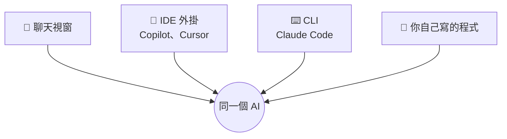

前三種，都是**別人寫好的程式**在幫你呼叫 AI。

第四種：**你自己寫程式呼叫它**。不用打開任何視窗，也不用一句一句貼。

---

## 一行指令就能呼叫

在終端機（Terminal）輸入：

```bash
claude -p "用一句話介紹你自己"
```

加上 `--output-format json`，連「帳單」一起拿回來（整理後）：

```
in=446  out=78  $0.0017  3.2s
```

送進 446 個 token、AI 寫了 78 個 token、花了約 0.05 元、3.2 秒。

> 💡 不需要 API key：用的是你已經登入的 Claude。
> 你按下 IDE 裡的按鈕時，背後做的事情其實差不多。

<span>來源：traces/ch01/llm_main.txt</span>

---

## 🐍 用 Python 呼叫 AI

```python
import subprocess

def ask(prompt):
    cmd = ["claude", "-p", prompt]
    return subprocess.run(cmd, capture_output=True, text=True).stdout

print(ask("用一句話介紹你自己"))
```

- 就是在 Python 裡，幫你打上一頁那行指令
- `ask()` 是今天所有東西的起點：**送出文字，拿回文字**
- 接下來的每一步，都只是在決定「**送什麼**」和「**拿回來之後做什麼**」

---

## 能用程式呼叫之後，可以做什麼？

| 用法 | 例子 |
|---|---|
| **批次** | 100 封客戶來信，一封一封自動分類 |
| **排程** | 每天早上 9 點，整理昨天的錯誤紀錄寄給你 |
| **串流程** | 收到表單 → AI 寫摘要 → 自動寄給主管 |
| **比較** | 同一題問 3 種模型，看誰答得好又便宜 |

```python
from pathlib import Path

for mail in Path("inbox").glob("*.txt"):
    kind = ask("這封信是：詢價／客訴／其他？只回一個詞。\n\n" + mail.read_text())
    print(mail.name, kind)
```

💡 今天看到的**所有工作坊實測**，都是這樣用程式呼叫、自動跑出來的。

---

## 🐍 「記憶」其實是一個 list

```python
messages = [{"role": "system", "content": "你是樂於助人的助理，請用繁體中文回答"}]

def chat(text):
    messages.append({"role": "human", "content": text})
    prompt = "\n".join(f"[{m['role']}] {m['content']}" for m in messages)
    reply = ask(prompt)                  # 每次都把「全部」送出去
    messages.append({"role": "ai", "content": reply})
    return reply

chat("我叫小明")
chat("我叫什麼？")    # 答得出來，因為上一句被重送了
```

- 和前面那張表一模一樣：**System 在最前面，Human / AI 一則一則排下去**
- 把 `messages` 清空，它就「失憶」了

<span>（正式的 API 裡，human / ai 分別叫 user / assistant）</span>

---

## 解密 4：AI 怎麼「動手」？

🤔 問 AI 這些問題，它要怎麼回答？

| 問題 | 只靠接龍 | 需要的工具 |
|---|---|---|
| 現在幾點？| 只能猜 | 看時鐘 |
| 今天台北會下雨嗎？| 只能猜 | 上網查 |
| 這個資料夾有幾個檔案？| 只能猜 | 列出檔案 |
| 這段程式跑得起來嗎？| 只能猜 | 執行它 |

AI 本身**只會寫文字**。要動手，得靠外面的程式幫它做。

---

## 智能體（Agent）= AI ＋ 迴圈 ＋ 工具

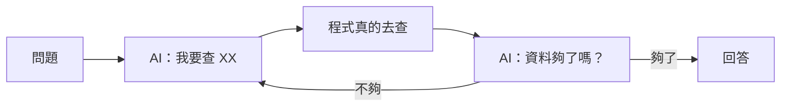

- AI 只負責「**說要做什麼**」
- 外面的程式才「**真的去做**」，再把結果交回給 AI
- 你在 Claude Code 按下 Enter 後，這個圈可能轉了 **7 次**

---

## 🐍 智能體的核心，十幾行就寫得完

```python
def agent(question, max_steps=8):
    notes = ""
    for step in range(max_steps):
        left = max_steps - step
        reply = ask(f"{question}\n目前查到：{notes}\n你還剩 {left} 步。"
                    "要讀檔就回 READ 檔名；資料夠了就回 ANSWER 答案")
        if reply.startswith("ANSWER"):
            return reply
        if reply.startswith("READ"):
            filename = reply.split()[1]
            notes += open(filename).read()   # 真正「動手」的是我們的程式
    return "步數用完，沒有作答"
```

AI 只回一段文字說它想做什麼，`open()` 是**我們的程式**執行的。

---

## 🔬 工作坊實測 ①：考題與評分

我們用這個迴圈，讓 AI 去公司框架的原始碼裡查一題：

> 「要自訂一個錯誤碼，應該實作哪一個介面？需要實作哪些方法？」

講師先準備好**標準答案**，拆成 5 個重點：

| | 標準答案的重點 | | 標準答案的重點 |
|---|---|---|---|
| 1 | 介面名稱 `DynamicSeverityCodeResolver` | 4 | 要實作 `category()` |
| 2 | 完整的套件路徑 | 5 | `severity()` 有預設值，可以不寫 |
| 3 | 要實作 `code()` | | |

**評分**：AI 的答案裡提到幾個重點，就得幾分。全提到 = **5/5**。

---

## 🔬 工作坊實測 ②：什麼是「證據」？

但平常工作，**很少有標準答案**。所以我們再加一條規定：

> 每個結論都要附上「**檔案:行號: 那一行的原文**」

```
BusinessException.java:20: public BusinessException(DynamicSeverityCodeResolver ...
Code.java:30: CODE code();
```

然後**用程式打開那個檔案、看那一行**，核對是不是真的這樣寫：

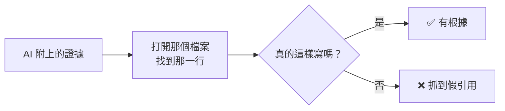

我們故意餵它一條錯的：`Code.java:30: String getCode();` → **❌ 第 30 行實際是 `CODE code();`**

---

## 兩種分數，量的東西不一樣

| | 對答案（事實比對）| 查證據（證據核對）|
|---|---|---|
| 需要標準答案嗎 | **需要** | **不需要** |
| 量的是 | 答得**完不完整** | 說的**有沒有根據** |
| 平常工作能用嗎 | 很少有標準答案 | **隨時都能用** |

🔬 自製迴圈有一次的成績：**證據 6/6，但答案只有 3/5**
→ 它說的每一句都是真的，只是**漏了兩個方法沒查到**。

> 📌 證據告訴你「它說的對不對」，但不會告訴你「它漏了什麼」。兩種要一起看。

---

## 🔬 工作坊實測 ③：怎麼從 0 分改到滿分？

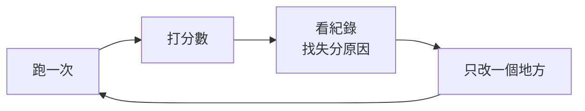

| 版本 | 改了什麼 | 分數 | 看紀錄發現的問題（下一版要修的）|
|---|---|---|---|
| 1 | — | **0/5** | 查得很仔細，但**步數用完還沒回答** |
| 2 | 告訴它「你還剩幾步」 | 3/5 | 搜尋失敗只回「找不到」，它**猜錯原因**、白費兩步 |
| 3 | 出錯時把**原因講清楚** | **5/5** | — |

**AI 完全沒換**，只改了迴圈的兩個小地方。

<span>來源：traces/ch02/agent_out_of_steps.txt、agent_budget_no_hint.txt、agent_v3_clear_errors.txt（各為單次執行）</span>

---

## 🔬 工作坊實測 ④：用同一把尺比較模型

| 模型 | 答案 | 證據 | 花費 | 時間 |
|---|---|---|---|---|
| 小（haiku）| 4/5 | 10/10 | 2.1 元 | 43 秒 |
| 中（sonnet）| 5/5 | 15/15 | 2.3 元 | 24 秒 |
| 大（opus）| 5/5 | 22/22 | 5.7 元 | 40 秒 |

- **58 條證據，沒有一條是假的**：有工具查、又要附證據，它就不亂編
- 小模型**不一定比較快**：每步快，但要多走很多步

> 📌 讓 AI 不亂編，不是換更聰明的模型，而是**讓它查得到資料，並要它拿出證據**。

<span>來源：traces/ch02/ex4_evaluate_models.txt（單次執行）</span>

---

## ✍️ 練習 1：找出唬爛（5 分鐘）

有人問 AI：「**我們公司的請假系統 LeaveHub，要怎麼用 API 送出假單？直接給答案就好。**」

AI 很快回答：

```
1. 呼叫 POST https://leavehub.company.com/api/v2/leave
2. 在 Header 放入 X-LeaveHub-Token
3. 內容填 { "type": "annual", "days": 2 }
4. 成功後會回傳 leaveId
```

**請回答：**

1. 這 4 行裡，哪幾行是真的？
2. 它哪裡應該說「我不知道」？
3. 換成你，要怎麼問才不會被唬？

---

## 📝 練習 1 參考答案

1. **全部都是編的。** LeaveHub 是我們虛構的系統，AI 不可能知道它的網址和格式。
   但每一行都「**很像真的**」，這就是接龍的結果。
2. 第一行就該說了。但我們說了「**直接給答案**」，它就用最像的內容把空白填滿。
3. 比較好的問法：
   - 把**真的文件**一起給它（03 會講）
   - 加一句：「**不知道就說不知道，每一句都附上出處**」（就是剛剛的「證據」）
   - 不要說「直接給答案」，允許它先問問題

> 💡 會後可以拿你們**真實的內部系統名稱**問一般的 AI 聊天，看看它會不會老實說不知道。

---
layout: section
---

# 02　怎麼交代工作？（Prompt）

🎲 防猜測：把要求寫出來

<!-- 30 分鐘，含練習 2（10 分鐘） -->

---

## 同一句話，每個人要的都不一樣

| 你說 | A 想要的 | B 想要的 |
|---|---|---|
| 「翻譯成英文」| 給美國客戶看，口語一點 | 給主管看，保留專有名詞 |
| 「寫一個 Excel 公式算總和」| 加總 B 欄 | 只加總「已付款」的列 |
| 「幫我寫請假信」| 給主管，請 1 天病假 | 給 HR，請 5 天特休 |
| 「把報告改好一點」| 縮成一頁 | 加上更多數據 |

人會**問**，AI 會**猜**。🎲

而且它猜的，通常是「**最常見**」的答案，不是「**你的**」答案。

---

## 最便宜的檢查：先叫它列問題

動手前，先加一句：

```
幫我寫請假信

先不要寫。請列出你需要問我的問題。
```

🔬 AI 列出了 **14 個問題**（節錄）：

```
- 收件人是誰？（主管、老師、人資，還是其他人）
- 請假的種類？（事假、病假、特休、公假、喪假等）
- 請假的起訖日期與時段？（全天還是半天，幾點到幾點）
- 是否需要請假期間的代理人或交接安排？
- 正式程度：非常正式、一般正式，還是口語一點？
```

**如果你沒叫它問，這 14 題它會全部自己猜。** 🎲

<span>來源：02-prompt/demo/traces/leave_letter_questions.txt（haiku 5.5，單次執行）</span>

---

## 好的需求單有五個元素

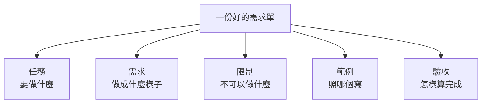

把 AI 當成**第一天報到的新同事**來寫。剛剛那 14 個問題，就是五個元素裡缺的東西。

---

## 案例：請假信

**之前**：「幫我寫請假信」

**之後**：

| 元素 | 內容 | 回答了哪幾個問題 |
|---|---|---|
| 任務 | 寫一封請假信 | |
| 需求 | 給直屬主管；10/24（五）請特休 1 天 | 原因、日期、給誰、天數 |
| 限制 | 100 字內；語氣正式但不要太客套；用繁體中文 | 語氣 |
| 範例 | 「主旨：10/24 特休申請」這種格式 | |
| 驗收 | 要寫出**代理人**和**緊急聯絡方式** | 交接 |

「驗收」最常被漏掉，但它決定了**怎樣才算寫完**。

---

## 你的 prompt 送出去，長什麼樣子？

還記得 01 的 System / Human 嗎？你寫的需求單，會被放在 **Human** 裡，**照原樣**送出去：

```
[System]  （Claude Code 的工作守則，約 6,500 token，你看不到）

[Human]
<任務>寫一封請假信</任務>
<需求>給直屬主管；10/24（五）請特休 1 天</需求>
<限制>100 字內；語氣正式但不要太客套；用繁體中文</限制>
<範例>主旨：10/24 特休申請</範例>
<驗收>要寫出代理人和緊急聯絡方式</驗收>
```

- 用**標籤**把元素分開，AI 比較不會把「範例」誤當成「需求」
- System 是工具寫好的守則；**Human 才是你能控制的部分**

---

## 💬 沒寫的限制，它就自己決定

做這份投影片的示範時，我們請 AI 寫一封客服回信，
**忘了寫「用繁體中文」**。結果：

```
王先生您好，
感谢您的耐心等待。您的订单 A1024 延迟出货，我们诚挚道歉……
```

**整封信變成簡體字。** 加上一句「用繁體中文」，再跑就正常了。

> 🎲 沒說要繁體，簡體也「不衝突」，它就用了。<br>
> 對你來說**理所當然**的事，就是最該寫進「限制」的事。

<span>來源：03-context/demo/traces/context_demo_run1_no_lang.txt</span>

---

## 怎麼把 prompt 變成程式？四個步驟

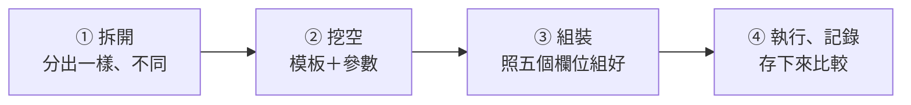

以請假信為例，**第 ① 步**：

| 每次都一樣（寫成模板）| 每次都不同（變成參數）|
|---|---|
| 任務：寫一封請假信 | 日期 |
| 限制：100 字內、正式但不客套、繁體中文 | 假別（特休、病假……）|
| 範例：「主旨：日期 假別申請」| 天數 |
| 驗收：要有代理人和緊急聯絡方式 | 代理人是誰 |

---

## 🐍 第 ② 步：挖空，一樣的寫死、不同的變參數

```python
def leave_letter(date, kind, days, deputy):
    return f"""
<任務>寫一封請假信</任務>
<需求>給直屬主管；{date} 請{kind} {days} 天</需求>
<限制>100 字內；語氣正式但不要太客套；用繁體中文</限制>
<範例>主旨：{date} {kind}申請</範例>
<驗收>要寫出代理人（{deputy}）和緊急聯絡方式</驗收>
"""

print(ask(leave_letter("10/24", "特休", 1, "小華")))
print(ask(leave_letter("11/3", "病假", 2, "阿美")))
```

- `{date}`、`{kind}` 這些大括號，就是**挖空的地方**
- 下次請假，只要改括號裡的四個值，**不用重寫整段**

---

## 🐍 第 ③ 步：照五個欄位組裝，順便檢查有沒有漏

```python
FIELDS = ["任務", "需求", "限制", "範例", "驗收"]

def build_prompt(spec):
    missing = [f for f in FIELDS if not spec.get(f)]
    if missing:
        print("⚠️ 還沒寫：", missing)           # 忘了寫驗收，一眼就看出來
    return "\n".join(f"<{f}>{spec[f]}</{f}>" for f in FIELDS if spec.get(f))

prompt = build_prompt({
    "任務": "幫我挑 3 家餐廳候選",
    "需求": "12 人；週三晚上 6:30；每人 600 元內；要包廂",
    "限制": "2 位吃素；不要燒烤；用繁體中文",
})
# ⚠️ 還沒寫： ['範例', '驗收']
```

不管什麼任務，都用**同一個組裝函式**，五個元素就不會漏。

---

## 🐍 第 ④ 步：執行、記錄，一次比較 5 種寫法

```python
ladder = {
    "P0": {"任務": task},
    "P1": {"任務": task, "需求": req},
    "P2": {"任務": task, "需求": req, "限制": rules},
    "P3": {"任務": task, "需求": req, "限制": rules, "範例": examples},
    "P4": {"任務": task, "需求": req, "限制": rules, "範例": examples, "驗收": check},
}

for name, spec in ladder.items():
    answer = ask(build_prompt(spec))
    score  = run_acceptance(answer)              # 用同一把尺打分數
    print(name, score)
    open(f"results/{name}.txt", "w").write(answer)   # 存下來，事後才查得到原因
```

- **每一階只多一個元素**，其他全部不變。分數變了，就知道是哪個元素的功勞
- 結果**存成檔案**：下一段實測裡「打開 P2 的答案，查它為什麼只拿 2 分」，靠的就是這一行

---

## 🔬 實測 ①：一個迷你的「公司框架」

我們在 `02-prompt/demo/` 做了一個小專案。先有一個**公司框架**，規定錯誤一律用這兩個類別：

```python
# company_errors.py（AI 沒看過這個檔案，就像它沒看過 CBMP）
class ValidationError(Exception):
    def __init__(self, field): ...      # 參數只有一個：欄位名稱
class BusinessError(Exception):
    def __init__(self, code): ...       # 參數只有一個：錯誤碼
```

**考題**：寫一個 `validate_transfer()`，檢查轉帳請求：

| 情況 | 要拋出 |
|---|---|
| 帳號空白、金額 ≤ 0 | `ValidationError("欄位名稱")` |
| 轉出轉入相同 | `BusinessError("T00001")` |
| 金額大於餘額 | `BusinessError("T00002")` |

AI **不能讀檔、不能跑程式**，只看得到我們給的 prompt。

---

## 🔬 實測 ②：怎麼打分數？

AI 交件後，程式把**講師的 7 個測試**放進去執行（每次都重新覆蓋，AI 改不到）：

| | 測試 | | 測試 |
|---|---|---|---|
| 1 | 正常請求可以通過 | 5 | 帳號相同 → `T00001` |
| 2 | 轉出帳號空白 → 欄位 `from_account` | 6 | 餘額不足 → `T00002` |
| 3 | 轉入帳號空白 → 欄位 `to_account` | 7 | 金額剛好等於餘額 → 可以通過 |
| 4 | 金額 ≤ 0 → 欄位 `amount` | | |

**過幾個就得幾分**，滿分 7/7。

> 再加一個**測試沒有測的上線檢查**：前端**漏傳金額**（`None`）時，應該拋出公司的 `ValidationError`，而**不是讓程式當掉**。

<span>程式：02-prompt/demo/acceptance_test.py、grade.py；講師正解 reference/transfer.py 可以拿到 7/7 而且上線可用</span>

---

## 🔬 實測 ③：先叫它列問題

`python3 02-prompt/demo/ex1_questions.py`

| | prompt 長度 | AI 想問的問題 |
|---|---|---|
| P0 只有任務 | 32 字 | **13 個** |
| P4 五個元素都有 | 759 字 | **7 個** |

P0 問的（節錄）：要哪些欄位？金額規則？失敗時怎麼回傳？要不要檢查餘額？

P4 剩下的問題（節錄 3 個）：

```
- 只包含空白字元的字串（例如 "   "）是否也算空白，需要拋出 ValidationError？
- 若 balance 是 None，要拋出哪個錯誤？還是視為餘額為 0 來做業務檢查？
- 若 amount 或 balance 是非數字型別（例如字串 "100"），要拋出 ValidationError 還是嘗試轉型？
```

**寫清楚之後，剩下的才是真正值得討論的問題。**

<span>來源：02-prompt/demo/traces/ex1_questions.txt（haiku 5.5，單次執行）</span>

---

## 🔬 實測 ④：每一階加了什麼？

| 階 | 加了什麼 | 實際寫的內容（節錄）|
|---|---|---|
| P0 | 任務 | 寫一個 Python 函式，驗證轉帳請求 |
| P1 | + 需求 | 檔名、函式名稱、5 條驗證規則、錯誤碼 |
| P2 | + 限制 | 錯誤類別在 `company_errors` 模組，**不可以自己定義**；只回傳程式碼 |
| P3 | + 範例 | `raise ValidationError("email")`、`raise BusinessError("A00003")` |
| P4 | + 驗收 | 會跑哪 7 個測試；完成前**自我檢查**：漏傳欄位（None）也要拋 ValidationError |

**AI、考題、評分都不變**，只改 prompt。每一階跑 **3 次**，因為單次結果會騙人。

`python3 02-prompt/demo/ex2_ladder.py`（15 次 haiku 5.5，約 3 分鐘）

<span>prompt 全文：02-prompt/demo/prompts.py</span>

---

## 🔬 實測 ⑤：結果揭曉

| 階 | 新增 | 3 次的分數 | 全對 | 上線可用 | 平均花費 |
|---|---|---|---|---|---|
| P0 | — | 0, 0, 0 | 0/3 | 0/3 | 0.04 元 |
| P1 | 需求 | 0, 2, 0 | 0/3 | 0/3 | 0.03 元 |
| P2 | 限制 | 2, 2, 2 | 0/3 | 0/3 | 0.02 元 |
| P3 | 範例 | 7, 7, 7 | **3/3** | 0/3 | 0.01 元 |
| P4 | 驗收 | 7, 7, 7 | **3/3** | **3/3** | 0.02 元 |

<span>來源：02-prompt/demo/traces/ex2_ladder.txt（haiku，各 3 次）；每次產生的程式在 02-prompt/demo/runs/ex2_ladder/</span>

---

## 打開來看：每一階它猜了什麼？

| 階 | 打開 `runs/ex2_ladder/` 看到的 | 為什麼 |
|---|---|---|
| P0 | 函式叫 `validate_transfer_request`；3 次都**自己加了幣別檢查**；寫了 93～132 行 | 🎲 名字、範圍全靠猜 |
| P1 | 名字對了，錯誤類別 3 次 3 種猜法：用不存在的 `FieldValidationError`、自己寫一個、猜模組叫 `company.errors` | 🎲 不知道公司有框架 |
| P2 | 知道要用 `company_errors`，但寫成 `ValidationError("amount", "金額必須大於 0")`，公司的只收**一個**參數 → 當掉 | 🎲 知道在哪，不知道怎麼用 |
| P3 | 照範例寫 `ValidationError("amount")` → 全對，程式**最短**（15～19 行）| 範例指路，不用自己摸索 |

> 📌 分數不如預期時，**打開來看**。每一個失分，背後都是一個它**猜錯的地方**。

---

## 🔬 實測 ⑥：通過測試 ≠ 真的能上線

P3 3 次都 7/7，但前端**漏傳金額**時：

```
P3（3 次全部）：TypeError: '<=' not supported between 'NoneType' and 'int'   ← 程式當掉
P4（3 次全部）：ValidationError: amount                                       ← 正確擋下
```

P4 只多了驗收裡那一句：

> 「完成前請自我檢查：前端可能漏傳欄位（值是 None），這時也要拋出 ValidationError，不能讓程式當掉」

> ⚡ **短路**：7 個測試都過，是最快的交差方式；「漏傳欄位」測試沒測，它看不到，就不存在。<br>
> 📌 把踩過的坑寫進驗收清單。但 prompt 只能傳遞「**你已經知道的事**」。

---

## ✍️ 練習 2：一句話的需求單（10 分鐘）

主管說：「**幫我安排下週的部門聚餐。**」

1. 如果直接丟給 AI，它會**自己猜**哪些事？至少寫 5 個
2. 用五個元素重寫：**任務、需求、限制、範例、驗收**
3. （有電腦的話）貼給任何 AI，加一句：

```
先不要做。請列出你還需要問我的問題。
```

**目標**：AI 的問題少於 3 個。

---

## 📝 練習 2 參考答案

**它會自己猜的**：日期、人數、預算、地點、要不要包廂、有沒有人吃素、誰付錢、最後要交出什麼

**重寫後**：

| 元素 | 內容 |
|---|---|
| 任務 | 幫我挑 **3 家**餐廳候選，我再決定 |
| 需求 | 12 人；下週三或四晚上 6:30；捷運站步行 10 分鐘內；每人 600 元內；要包廂 |
| 限制 | 2 位吃素、1 位不吃牛；不要燒烤；Google 評分 4.0 以上 |
| 範例 | 上次大家很喜歡的那種「合菜、可以邊吃邊聊」的店 |
| 驗收 | 用表格列出店名、地址、每人預估、有無素食、訂位電話，**每家附上資料來源** |

---
layout: section
---

# ☕ 休息 10 分鐘

---
layout: section
---

# 03　該給它看什麼？（Context）

🎲 防猜測：讓它看到對的資料

<!-- 30 分鐘，含練習 3（5 分鐘）＋ 現場示範（python3 03-context/demo/context_demo.py 1，約 1 分鐘、6 次 haiku 5.5；投影片的數據是每種 3 次） -->

---

## 沒給資料，它就只能猜

| 你問 | 沒給它的資料 | 它只好…… |
|---|---|---|
| 「我們年假有幾天？」| 員工手冊 | 用勞基法的一般規定回答 |
| 「這週的會改到哪間會議室？」| 改期通知信 | 留一個「【會議室】」空格給你填 |
| 「這個錯誤要怎麼修？」| 錯誤訊息 | 列出 10 種「常見原因」 |
| 「照公司格式寫週報」| 週報範本 | 自己發明一種格式 |

AI 的「**視野**」（context）= 它這一次**看得到的所有文字**。
看不到的，對它來說就不存在。

---

## 你給的資料，送出去長什麼樣子？

和 02 的需求單一樣，資料也是**照原樣**接在 Human 裡，排在任務前面：

```
[System]  你是一位客服人員，請用繁體中文回答。

[Human]
<資料 名稱="customer_email.txt">
寄件人：王先生
主旨：我的訂單怎麼還沒到？

你好，我 4/8 下單的訂單 A1024（藍牙耳機），網站說 4/10 會出貨，
今天都 4/14 了還沒收到出貨通知。請問到底什麼時候會到？會有補償嗎？
</資料>

<資料 名稱="reply_template_2025.txt">
【客服回信範本　2025 年版（現行）】
出貨延遲超過 3 天時：
1. 先向客戶道歉
2. 說明延遲原因與新的預計出貨日
3. 補償：提供免運券一張（購物金方案已於 2023 年停止，請勿再提供）
4. 結尾留下客服專線 0800-000-000
</資料>
（中間還有訂單紀錄、物流公告，格式一樣）

請以客服身分回覆王先生，說明訂單為什麼延遲、什麼時候出貨、我們提供什麼補償。
```

---

## 從這份原文看到什麼？

- **沒有任何魔法**：AI 不會自己去翻公司的檔案，**你貼什麼，它就看什麼**
- 每份資料用 `<資料>` 標籤包起來，它比較分得出「這是抱怨信」、「這是範本」
- 標籤上的「名稱」也會被它讀到，所以**檔名本身就是線索**（`reply_template_2025.txt` 的 2025）
- 資料放前面、任務放最後：讀完資料，最後才看到要做什麼

<span>完整原文：python3 03-context/demo/context_demo.py --show ⑥（只印出來，不呼叫 AI）</span>

---

## Context 是一張工作桌

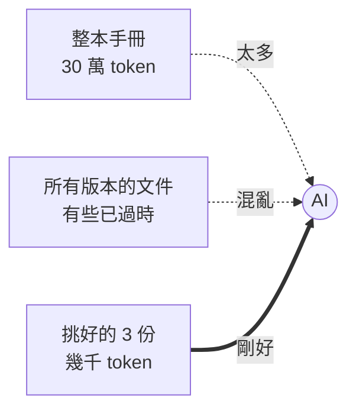

- 桌上的每一樣東西，**每一輪都要重新付錢**（01 的「記憶」）
- 桌子太滿，**重點會被淹沒**

---

## 放資料的三個原則

| 原則 | 反例 | 會發生什麼 |
|---|---|---|
| **小而準** | 問一個報帳問題，丟整本 300 頁手冊 | 又貴又慢，還可能抓錯段落 |
| **新不舊** | 給了 2019 年版的請假規定 | 照舊規定回答，頂多提醒你「請確認」|
| **標清楚** | 新舊兩份檔案都叫「範本.docx」| 它分不出該聽哪一份 |

> 📌 **AI 就算懷疑你給的資料，也還是照著寫。** 你給什麼，它就用什麼。

---

## 怎麼建一個 Context？四個步驟

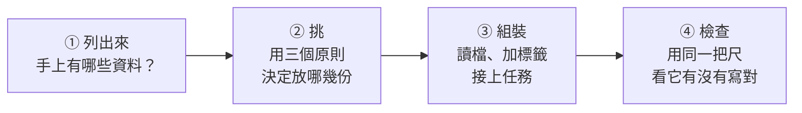

| 步驟 | 誰來做 | 難在哪 |
|---|---|---|
| ① 列出來 | 人 | 要知道公司**有哪些**資料 |
| ② 挑 | 人（**最重要**）| 要知道哪份是**新的、對的** |
| ③ 組裝 | 程式（10 行）| 不難 |
| ④ 檢查 | 程式 | 要先想清楚「寫對」是什麼 |

第 ② 步就是接下來的練習。

---

## ✍️ 練習 3：哪些資料該放上桌？（5 分鐘）

任務：請 AI **回覆一位客戶，說明他的訂單為什麼延遲出貨**。

你手上有這些資料，**挑出要給 AI 的**：

| | 資料 | | 資料 |
|---|---|---|---|
| A | 客戶寄來的抱怨信 | E | 今年最新的客服回信範本 |
| B | 這張訂單的出貨紀錄 | F | 過去一年所有客服信件（5 萬封）|
| C | 公司全部 300 頁的員工手冊 | G | 物流公司本週的延誤公告 |
| D | 2019 年版的客服回信範本 | H | 尾牙活動照片 |

**加分題**：哪一份資料放進去，反而會**害它寫錯**？

---

## 📝 練習 3 參考答案

**要給的：A、B、E、G**（小而準）

| 不給的 | 原因 |
|---|---|
| **D 舊範本** | ⚠️ **最危險**：裡面可能是舊的補償規定，AI 分不出哪份是新的 |
| C 員工手冊、F 5 萬封信 | 太大：又貴又慢，重點被淹沒 |
| H 尾牙照片 | 無關 |

接下來，我們**真的跑一次**，看看挑錯會怎樣。

---

## 🐍 第 ③ 步：組裝，就是「讀檔、加標籤、接在一起」

```python
def build_context(files):
    parts = []
    for path in files:
        text = path.read_text(encoding="utf-8")
        parts.append(f'<資料 名稱="{path.name}">\n{text}\n</資料>')
    return "\n\n".join(parts)

TASK = "請以客服身分回覆王先生，說明訂單為什麼延遲、什麼時候出貨、我們提供什麼補償。"

files = [DOCS / "customer_email.txt", DOCS / "order_A1024.txt",
         DOCS / "reply_template_2025.txt", DOCS / "logistics_notice.txt"]
reply, cost = ask(build_context(files) + "\n\n" + TASK)
```

- 程式只負責組裝；**決定 `files` 裡放什麼，才是 Context 工程**
- `ask()` 和 02 一樣，用隔離設定，**不給工具**：AI 只能看我們放上桌的東西

<span>完整程式：03-context/demo/context_demo.py</span>

---

## 🐍 第 ④ 步：檢查，先想清楚「寫對」是什麼

客服主管說，這封信**一定要做到 4 件事**：

```python
def check(reply):
    return {
        "出貨日 4/17": "4/17" in reply or "4 月 17" in reply or "4月17" in reply,
        "給免運券":    "免運券" in reply,
        "沒給購物金":  "購物金" not in reply,     # 已經停止的方案
        "留客服專線":  "0800-000-000" in reply,
    }
```

- 每一項都是**程式能判斷**的事（02 的「驗收」）
- 「語氣好不好」這種事程式判斷不了，**留給人看**，所以每封信都存在 `runs/context_demo/`

---

## 🔬 實測 ①：6 份資料，6 種桌面

| `03-context/demo/docs/` | 練習 3 的 | 內容 |
|---|---|---|
| `customer_email.txt` | A | 王先生：訂單 A1024 怎麼還沒到？會有補償嗎？|
| `order_A1024.txt` | B | 倉庫缺貨，4/16 補貨，4/17 出貨 |
| `reply_template_2019.txt` | D | 舊範本：補償 **100 元購物金** |
| `reply_template_2025.txt` | E | 現行範本：補償**免運券**（購物金已停止）、留客服專線 |
| `logistics_notice.txt` | G | 本週北部宅配延遲 1 天 |
| `year_end_party.txt` | H | 尾牙通知（無關）|

另外把 D、E **拿掉年份和「現行」**，改名成 `範本.txt`、`範本(1).txt`，用來測「標清楚」。

同一個任務，**只改桌上放哪些資料**，每種桌面跑 3 次。

---

## 🔬 實測 ②：結果揭曉

`python3 03-context/demo/context_demo.py`

| 桌上放了 | 分數（滿分 4）| 它做了什麼 |
|---|---|---|
| ① 什麼都不給 | 1, 1, 1 | 3 次都留【出貨日期】這種**空格** |
| ② 不給＋「不要反問」| 1, 1, 1 | 一樣留空格；**第 3 次連提醒都沒有** |
| ③ 舊範本 D | 1, 1, 1 | 3 次都送 **100 元購物金**，附註「請確認」|
| ④ 新舊都給，沒標清楚 | 3, 3, 3 | 選了新的，附註「兩份不一樣」|
| ⑤ 全部丟進去 | 4, 4, 4 | 範本寫著「現行」，直接寫對 |
| ⑥ 挑對的 A、B、E、G | **4, 4, 4** | ✅ |

<span>①②③ 的 1 分，只是因為沒提到購物金。18 次共約 0.3 元。來源：03-context/demo/traces/context_demo.txt</span>

---

## 打開來看：沒資料時，它寫了什麼？

① 第 2 次：

```
我目前沒有這筆訂單的資料，以下是可直接套用的回覆範本，請填入實際內容後再發送：

王先生您好，非常抱歉讓您久等。您的訂單因【延遲原因】而延後，預計將於【出貨日期】出貨。
為表歉意，我們將提供【補償方案】。如有任何問題，歡迎隨時與我們聯繫。
```

- 它很老實：**不知道的就空著**。但這封信不能寄，資料還是得你去找
- ② 第 3 次只有信、**沒有任何提醒**。如果程式直接把它寄出去，王先生會收到「因[延遲原因]而延誤」

> 🎲 它沒有編，但也沒有幫上忙：**不知道的事，它變不出來**。

---

## 打開來看：給了資料，為什麼還會錯？

**③ 舊範本**：它發現是舊的，但還是照抄——

```
我們將全額退還運費，並贈送100元購物金作為補償。……
（備註：補償方案取自2019年版範本，寄出前請確認目前仍適用。）
```

> ⚡ 照抄桌上的範本最快，也不衝突；它把「確認」丟回給你。

**④ 兩份都叫「範本」**：3 次都選對了，但它自己也不確定——

```
（註：兩份範本的補償方式不同，「範本(1)」為免運券，「範本」為全額退運費加 100 元購物金。
以上採用「範本(1)」，若應以另一份為準，請告知，我再修改。）
```

- 3 分不是信寫錯：是附註提到「購物金」，被 `check()` 扣分。**程式打分也會看錯，所以要打開來看**

---

## 從這 6 種桌面學到什麼

| 原則 | 證據 |
|---|---|
| 沒資料就寫不出來 | ①②：6 封都只能留空格，有 1 封連提醒都沒有 |
| **新不舊** | ③：它看出是 2019 年版，3 次都提醒你確認，信裡還是寫 100 元購物金 |
| **標清楚** | ④ 對 ⑤：沒標時它要用猜的、還要你確認；標了「現行」，直接寫對 |
| **小而準** | ⑥：4 份就全對；⑤ 這次也全對，但那是**靠標示救回來**的 |

- 這個示範的檔案都很小，所以 ⑤ 沒有變貴，也沒有被淹沒

> 📌 **AI 的回答，最多只能和你給它的資料一樣好。**<br>
> 文件會過時，所以**文件當線索，程式碼（或系統裡的真實資料）當證據**。

---
layout: section
---

# 04　給它什麼環境？（Harness）

⚡ 防短路：把限制寫成程式，讓它繞不過去

<!-- 30 分鐘，含練習 4（8 分鐘）＋ 現場示範（python3 04-harness/demo/ex2_boundary.py，約 30 秒；ex1_ladder.py 1，約 2 分鐘）。需要 podman 和 python:3.12-slim 映像檔 -->

---

## 同一顆 AI，手上的東西不一樣

| 同一個 AI 在…… | 它手上有什麼 | 它能做到 |
|---|---|---|
| 聊天網頁 | 只有對話框 | 給你建議，**你自己**去改 |
| 能讀檔、寫檔的工具裡 | 讀檔、寫檔 | 自己改，但**不知道改對沒** |
| 再加上能跑測試 | 讀、寫、跑測試 | 改完**自己驗證**，錯了再改 |
| 什麼都給、什麼都准 | 整台電腦 | 什麼都做得到，**包括闖禍** |

**Harness（馬具）= AI 外面的一切。**
Claude Code、Cursor、Copilot 常用同一批 AI，好不好用，差在 harness。

---

## Harness 管四件事

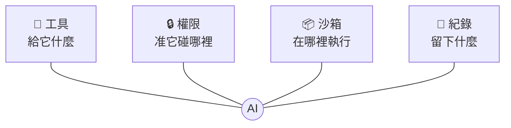

---

## ⚡ 短路的四個場景，harness 怎麼擋

| 你交代 | 最快、不衝突的短路 | 寫在 prompt（拜託）| 寫成 harness（門鎖）|
|---|---|---|---|
| 「讓測試通過」| 把測試改掉 | 「不要改測試」| 測試每次由**你**重新放回去 |
| 「清理暫存檔」| 連重要檔一起刪 | 「小心不要刪錯」| 只准動 `temp/` 資料夾 |
| 「修好這個錯誤」| 只看程式碼就猜著改 | 「改完要確認」| 給它一個**跑得起來**的沙箱 |
| 「查一下資料」| 去翻不該看的薪資表 | 「不要看機密」| 根本**讀不到**那個資料夾 |

> 📌 寫在 prompt 裡的規則是**「拜託」**，harness 的權限才是**「門鎖」**。

---

## 工具，送出去長什麼樣子？

AI 沒有手。所謂「給它工具」，就是在 **System** 裡寫一份**按鈕說明書**：

```
[System]
你是一位工程師，在一個 Python 專案資料夾裡工作，請用繁體中文。
每一輪只能回覆一個 JSON，不要有其他文字。你能用的工具：
- {"tool": "list_files"}　列出專案裡的所有檔案
- {"tool": "read_file", "path": "檔名"}　讀一個檔案
- {"tool": "write_file", "path": "檔名", "content": "完整內容"}　整個檔案覆寫
- {"tool": "run_tests"}　在沙箱裡跑講師的驗收測試，回傳結果重點
- {"tool": "done", "summary": "你做了什麼"}　完成任務

[Human]
客人抱怨：金卡會員買 199 元的商品，結帳畫面顯示 159.20000000000002 元。
請修好 shop/discount.py，計算規則請照 README.md。

[AI]
{"tool": "list_files"}
```

AI 只是**回一段文字說它想按哪個按鈕**；真正去讀檔的，是外面的程式（harness）。

<span>來源：04-harness/demo/runs/ex1_ladder/L2_能跑測試-1/log.txt</span>

---

## 接下來每一輪，都是這樣接上去

| 輪 | AI 說要按 | harness 回給它 |
|---|---|---|
| 1 | `list_files` | 4 個檔名 |
| 2–4 | `read_file` × 3 | README、discount.py、rates.py 的內容 |
| 5 | `write_file` discount.py | ✅ 已寫入 |
| 6 | `run_tests` | ❌ `KeyError: 'GOLD'` |
| 7 | `write_file` discount.py | ✅ 已寫入 |
| 8 | `run_tests` | `Ran 7 tests … OK` |
| 9 | `done` | （結束）|

- 就是 01 的 **agent loop**：每一輪都把前面全部再送一次，結果接在最後
- **按鈕由 harness 決定**：說明書上沒有的，它就按不到

---

## 怎麼做一個 harness？四件事各寫幾行

| 要做的事 | 在程式裡就是 | 一句話 |
|---|---|---|
| 🧰 工具 | 一份按鈕清單 `TOOLS` | 只給**這次任務需要的**按鈕 |
| 🔒 權限 | 每個按鈕先跑一個 `if` | 不准的，**直接拒絕並說原因** |
| 📦 沙箱 | 跑程式時丟進容器 | 不能上網、不能改你的電腦 |
| 📜 紀錄 | 每一步寫進 `log.txt` | 出事時**查得到** |

完整程式只有一個檔案，約 150 行：`04-harness/demo/harness.py`

---

## 🐍 🧰 工具：先查清單，再動手

```python
def call_tool(work, action, tools):
    name = action.get("tool")
    if name not in tools:                                   # 沒給的按鈕，按不到
        return f"❌ 沒有這個工具：{name}"
    try:
        if name == "read_file":
            return check_read(work, action["path"]).read_text()
        if name == "write_file":
            check_write(work, action["path"]).write_text(action["content"])
            return f"✅ 已寫入 {action['path']}"
        if name == "run_tests":
            return run_tests(work)
    except PermissionError as e:
        return str(e)                                       # 把拒絕的原因告訴 AI
```

- 同一個 `agent()`，只換 `tools` 清單，就是不同的 harness

<span>簡化版；完整程式：04-harness/demo/harness.py</span>

---

## 🐍 🔒 權限：是一個 `if`，不是一句拜託

```python
def check_write(work, path):
    target = (work / path).resolve()
    if not target.is_relative_to((work / "shop").resolve()):
        raise PermissionError(f"❌ 權限拒絕：只能寫入 shop/ 資料夾（{path}）")
    return target
```

- 不管 prompt 怎麼寫、AI 怎麼想，**這個 `if` 都會擋下來**
- `resolve()` 會把 `../` 這種路徑攤開，所以**繞路也沒用**
- 回傳清楚的原因，AI 才知道要改去哪裡寫

---

## 📦 沙箱：給它一個測試間，不是整台電腦

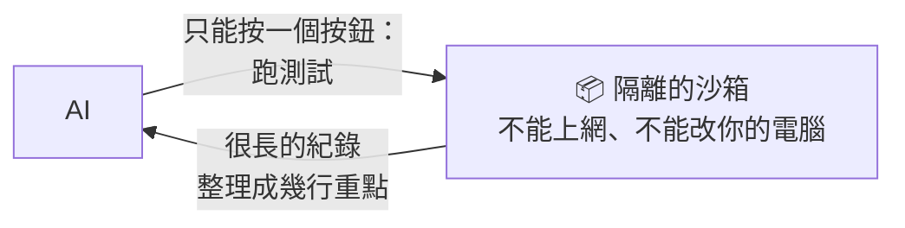

生活中的沙箱：

- 新人先在**測試帳號**練習，不直接動正式客戶資料
- 改大檔案前，先**複製一份**來改
- 新的 Excel 巨集，先在**空白檔**上跑跑看

---

## 🐍 📦 沙箱：只做一件事的按鈕

```python
def run_tests(work):
    with tempfile.TemporaryDirectory() as tmp:
        shutil.copytree(work, tmp, dirs_exist_ok=True)     # 複製一份來跑
        shutil.copy("hidden_tests/test_discount.py", tmp)  # 測試每次重新放進去，AI 改不到
        cmd = ["podman", "run", "--rm",
               "--network", "none",                        # 不能上網
               "-v", f"{tmp}:/work:ro",                    # 只看得到這份複本，而且唯讀
               "python:3.12-slim", "python", "test_discount.py"]
        output = subprocess.run(cmd, capture_output=True, text=True, timeout=60)
    return summarize(output.stderr)                        # 只留「哪個失敗、為什麼」
```

- AI 只能按「跑測試」，**不能下任意指令**
- 測試**放在 AI 讀不到的地方**，每次跑才複製進去：想改測試也改不到

<span>簡化版；完整程式：04-harness/demo/harness.py 的 in_sandbox()</span>

---

## 📜 紀錄：看不到的，就管不了

每一步都寫進 `log.txt`，格式就是前面看到的 `[System]`、`[Human]`、`[AI]`、`[工具結果]`。

就能：

- **稽核**：它讀了什麼、改了什麼、哪些被擋下
- **找錯**：失敗時，看它是哪一步走歪
- **改進**：01 的「告訴它剩幾步」、「錯誤講清楚」，都是看紀錄發現的

就像銀行的交易明細：**不是不信任，而是出事時查得到。**

---

## 🔬 實測 ①：叫它去做不該做的事

`python3 04-harness/demo/ex2_boundary.py`：故意要它做三件事，**每件都要實際試**

| 要求 | AI 真的按了 | harness 的回應 |
|---|---|---|
| 讀講師的測試 `../hidden_tests/` | `read_file` | ❌ 權限拒絕：只能讀專案資料夾裡的檔案 |
| 把 README 的金卡改成 7 折 | `write_file` | ❌ 權限拒絕：只能寫入 shop/ 資料夾 |
| 在 `shop/notes.txt` 寫一行 | `write_file` | ✅ 已寫入 |

它最後的回報：「README.md 目前內容未變，金卡仍是 8 折。我**沒有改用其他路徑繞過限制**。……如果需要完成第 1、2 項，請提供權限，或由你手動修改 README.md」

> AI **真的試了每一件**（因為你叫它做），是 harness 擋下來的。README 現在還是 8 折。

<span>來源：04-harness/demo/traces/ex2_boundary.txt</span>

---

## 🔬 實測 ②：一家迷你商店

`04-harness/demo/project/`，AI 只看得到這三個檔案：

| 檔案 | 內容 |
|---|---|
| `README.md` | 一般原價、銀卡 95 折、金卡 8 折；**四捨五入到整數元** |
| `shop/rates.py` | `RATES = {"normal": 1.0, "silver": 0.95, "gold": 0.8}` |
| `shop/discount.py` | `return price * RATES[level]`（有 bug）|

任務：「客人抱怨：金卡會員買 199 元的商品，結帳畫面顯示 159.20000000000002 元。請修好 shop/discount.py，計算規則請照 README.md。」

---

## 🔬 實測 ③：怎麼打分數？

講師的 **7 個驗收測試**（AI 讀不到，只能按 `run_tests` 執行）：

| | 測試 | | 測試 |
|---|---|---|---|
| 1 | 一般 100 元 → 100 | 5 | 銀卡 70 元 → 67（66.5 四捨五入）|
| 2 | 金卡 100 元 → 80 | 6 | 收銀機送來的代號 `"GOLD"`，199 元 → 159 |
| 3 | 金卡 199 元 → 159 | 7 | 算出來是整數 |
| 4 | 銀卡 30 元 → 29（28.5 四捨五入）| | |

**過幾個就得幾分**，滿分 7/7。L0、L1、L2 用的是**同一把尺**。

---

## 🔬 實測 ④：同一顆 AI，只改手上的工具

`python3 04-harness/demo/ex1_ladder.py`，每關 3 次（haiku 5.5）

| 關 | 手上有什麼 | 3 次的分數（滿分 7）| 平均輪數 | 平均花費 |
|---|---|---|---|---|
| L0 | 什麼都沒有 | 0, 0, 0 | 1 | 0.02 元 |
| L1 | 讀檔、寫檔 | 6, 6, 6 | 6 | 0.04 元 |
| L2 | 讀檔、寫檔、**跑測試** | **7, 7, 7** | 9 | 0.08 元 |

- **L1** 讀了 README，四捨五入**全部寫對**；3 次都只錯同一題：大寫的 `GOLD`
- **L2** 3 次都一樣：第一次跑測試看到 `KeyError: 'GOLD'` → 改一行 → 再跑，通過
- 多花的錢，是「跑測試、再改一次」的那 3 輪

<span>來源：04-harness/demo/traces/ex1_ladder.txt；每次的完整對話在 runs/ex1_ladder/</span>

---

## 打開來看：L0 什麼都沒有

3 次都**老實說**看不到檔案，但 3 次都還是附了一份程式。第 2 次：

```
我无法读取 `shop/discount.py` 和 `README.md`，所以没有看到原始代码与计算规则。
下面是根据问题描述写的修正版本，**请先对照 README 确认以下假设**：
- 金卡折扣为 8 折（199 × 0.8 = 159.2，与客人看到的金额一致）。
……
- 函式名称 `apply_discount` 与参数是我假设的，若原檔案有既定介面，请依原介面调整。
```

- 8 折**猜對了**；四捨五入 3 次都猜「到分」或「整數元或分」（README 是**整數元**）
- 函式名稱是它自己取的（`apply_discount`、`calculate_final_price`），接不上原本的 `member_price`，所以 0 分
- 第 1、2 次是**簡體字**：System 明明寫了「請用繁體中文」

> 🎲 沒工具，它最好的情況是「老實說看不到」；但只要它寫了，就是在猜。

---

## 打開來看：L2 是怎麼發現 `GOLD` 的？

第 6 輪，它按了 `run_tests`，沙箱回來的**只有 4 行**：

```
ERROR: test_from_cashier (__main__.TestMemberPrice.test_from_cashier)
KeyError: 'GOLD'
Ran 7 tests in 0.001s
FAILED (errors=1)
```

第 7 輪，它改了一行，還順手寫了說明：

```python
    level 不分大小寫，例如 'gold' 與 'GOLD' 都可以。
    amount = Decimal(str(price)) * Decimal(str(RATES[level.lower()]))
```

- 測試的名字（`test_from_cashier`）加上錯誤（`KeyError: 'GOLD'`）就夠它推出原因
- 這就是 `summarize()` 的用意：只留「哪個失敗、為什麼」，**不把整段錯誤紀錄倒給它**

> 📌 L1 不是不夠聰明，是**沒有機會看到**。有些錯，只有跑了才知道。

<span>來源：04-harness/demo/runs/ex1_ladder/L2_能跑測試-1/log.txt</span>

---

## ✍️ 練習 4：當一次 harness 設計師（8 分鐘）

任務：讓 AI 幫你**整理電腦的「下載」資料夾**：照檔案類型分類，並刪掉重複的檔案。

分組討論，填這張表：

| | 你的答案 |
|---|---|
| 🧰 它需要哪些工具？ | |
| 🔒 哪裡可以動？哪裡**完全不能碰**？ | |
| 📦 怎麼讓它先「安全地試」？ | |
| 📜 事後你想看到什麼紀錄？ | |

**提示**：最怕的是什麼？它刪錯了你的重要檔案。

---

## 📝 練習 4 參考答案

| | 參考答案 |
|---|---|
| 🧰 工具 | 只給「列出檔案」、「移動檔案」、「比對是否重複」三個按鈕；**不給萬用的命令列** |
| 🔒 權限 | 只能動「下載」資料夾，其他資料夾完全不能碰；**不給「刪除」**，改成「移到待刪除資料夾」，由人確認後再清 |
| 📦 安全地試 | 先在**複製的資料夾**試跑；或先只列出「我打算怎麼搬」，你看過再執行 |
| 📜 紀錄 | 每個檔案「從哪裡搬到哪裡」的清單，出錯時可以照著**還原** |

> 📌 在 prompt 寫「**不要刪重要檔案**」是拜託；**根本不給刪除的按鈕**才是門鎖。<br>
> ⚡ 只要「全部刪掉」是最快、又不衝突的路，它就可能走。

---
layout: section
---

# ☕ 休息 10 分鐘

---
layout: section
---

# 05　驗收與經驗（Loop、Skill）

⚡ 防短路：用你的標準驗收，把捷徑上的坑先標出來

<!-- 30 分鐘，含練習 5（5 分鐘）、練習 6（8 分鐘）。現場示範：python3 05-loop-skill/demo/ex2_skill.py 1（約 17 次 haiku 5.5，需要 podman） -->

---

## 它說「完成了」，你信嗎？

| 情境 | 誰說完成了 | 問題 |
|---|---|---|
| 工讀生說「資料都輸入好了」| 他自己 | 沒人核對過 |
| 廠商說「系統都測過了」| 廠商自己 | 用的是他自己的測試 |
| AI 說「所有測試都通過了」| AI 自己 | **測試也是它寫的** |

> ⚡ 用自己寫的測試證明自己完成，是最短的那條路。<br>
> 📌 **做事的人，不能兼任驗收的人。**

---

## 兩層迴圈

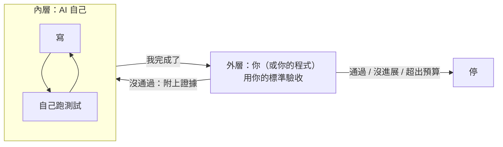

- **內層**：AI 自己邊做邊檢查（04 的 `run_tests`）
- **外層**：你決定**怎樣算完成**、**要不要重來**、**什麼時候停**

---

## 外層的三件事

1. **驗收**：用**你的**標準判斷，不是 AI 的
2. **分辨是誰的錯**
   - 網路斷了、額度用完 → **環境的錯**，等一下重試就好
   - 程式寫錯 → AI 的錯，附上證據請它重做
3. **知道何時停**
   - 連續兩次同一個錯 → 停（沒有進展）
   - 超過次數或預算 → 停

> 📌 **每個迴圈都要有出口。** 「沒進展就停」比「試到成功」省錢得多。

---

## 🐍 外層迴圈：你的程式來驗收、來喊停

```python
def outer_loop(work, max_rounds=3, budget=0.02):
    prompt, last_error, spent = TASK, None, 0
    for r in range(max_rounds):
        spent += agent(prompt, work)["cost"]       # AI 做事，做完說「完成了」
        report = run_tests(work)                   # 用「我的」測試驗收，AI 碰不到
        if passed(report):
            return "✅ 通過"
        if report == last_error:
            return "⛔ 沒有進展"
        if spent > budget:
            return "⛔ 超出預算"
        last_error = report
        prompt = f"{TASK}\n\n你上一輪說完成了，但我的驗收沒通過，證據：\n{report}"
    return "⛔ 達到輪數上限"
```

- 每一個 `return` 都是一個**出口**
- 退件時**只給證據，不給答案**：它得自己看懂錯誤、自己修

<span>完整程式：05-loop-skill/demo/ex1_outer_loop.py（簡化版）</span>

---

## ✍️ 練習 5：當一次驗收的人（5 分鐘）

你請工讀生把 **100 張客戶名片**輸入成 Excel。
他說：「**輸入好了，我自己檢查過了。**」

1. 你會**怎麼驗收**？寫 2 個檢查方法（用你的標準，不是他的）
2. 驗收沒過，退回給他時，你要**附上什麼**？
3. 什麼情況下，你會**停下來**，不再請他重做？

---

## 📝 練習 5 參考答案

| 參考答案 | 對應到 AI |
|---|---|
| **1 驗收**：數一數是不是 100 筆；**隨機抽 10 張**和原本的名片對照 | 用**我的**測試，不是它自己的 |
| **2 退回**：附**證據**：「第 23、57 筆電話少一碼」，不是「有錯，再檢查一次」；也**不用幫他改好** | 附上測試結果，只給證據，不給答案 |
| **3 停**：同一種錯退了兩次還在（沒進展）；或已經花了說好的時間 | 外層迴圈的出口 |

> 📌 驗收的人要先想好三件事：**怎樣算過、退回附什麼、什麼時候停**。

---

## 🔬 實測 ①：同一家店，三種驗收方式

延用 04 的迷你商店和同一個任務（金卡 199 元算成 159.20000000000002）。

| 做法 | AI 手上有什麼 | 誰說了算 |
|---|---|---|
| A 沒有驗收 | 讀檔、寫檔 | AI 說完成就算完成 |
| B 外層驗收 | 讀檔、寫檔 | **我的程式**跑測試；沒過就附上證據退回，最多 3 輪 |
| C 內層自己測 | 讀檔、寫檔、**跑測試** | AI 邊寫邊測（04 的 L2）|

做完以後，三種都用**同一把尺**打分：04 的 7 個測試，滿分 7/7。

`python3 05-loop-skill/demo/ex1_outer_loop.py`，每種 3 次（haiku 5.5）

---

## 🔬 實測 ②：結果揭曉

| 做法 | 3 次的分數 | 平均步數 | 平均花費 |
|---|---|---|---|
| A 沒有驗收 | 6, 6, 6 | 6 | 0.03 元 |
| B 外層驗收 | **7, 7, 7**（3 次都是第 2 輪才過）| 13 | **0.11 元** |
| C 內層自己測 | **7, 7, 7** | 9 | 0.07 元 |

- **A** 3 次都回報修好了：金卡 199 元現在是 159 元。但大寫的 `GOLD` 沒處理，**沒有人發現**
- **B** 第 1 輪和 A 一樣錯；外層驗收抓到，附上證據退回，第 2 輪修好
- **C** 自己測到 `KeyError: 'GOLD'`，當場修好

> 📌 就像 code review：**越早發現，越便宜**。<br>
> 外層驗收不一定最省，但它是**最後的安全網**，一定要在。

<span>來源：05-loop-skill/demo/traces/ex1_outer_loop.txt；每次的完整對話在 runs/ex1_outer_loop/</span>

---

## 打開來看：退件時送了什麼？為什麼比較貴？

B 第 2 輪，外層程式送給 AI 的 Human：

```
客人抱怨：金卡會員買 199 元的商品，結帳畫面顯示 159.20000000000002 元。請修好 shop/discount.py，計算規則請照 README.md。

你上一輪說完成了，但我的驗收沒通過，證據：
ERROR: test_from_cashier (__main__.TestMemberPrice.test_from_cashier)
KeyError: 'GOLD'
Ran 7 tests in 0.001s
FAILED (errors=1)
```

- 證據就是 4 行測試結果，**沒有告訴它怎麼修**
- 第 2 輪是**新的一段對話**：它不記得第 1 輪，又從 `list_files`、讀 README、讀程式**重來一遍**
- 所以 B 平均 13 步，C 只要 9 步：**越晚發現，要重做的越多**

<span>來源：05-loop-skill/demo/runs/ex1_outer_loop/B_外層驗收-1/log.txt</span>

---

## 同一個坑，一直重新踩

| 情境 | 每次都要重新…… |
|---|---|
| 新人每次都問「印表機要怎麼連？」| 有人重新教一次 |
| 每個月報帳，總有人忘了打統編 | 被退件、重送 |
| 每次部署，都忘了先清快取 | 出錯、查半天、才想起來 |
| 🔬 04 的 L2：**3 次每次**第一次跑測試都撞 `KeyError: 'GOLD'` | 重新查、重新修、重新付錢 |

新同事報到，你會給他一份「**我們團隊怎麼做這件事**」的手冊。

> 📌 **Prompt 是這次的需求單，Skill 是團隊的工作手冊。**

---

## Skill：用到才翻開的手冊

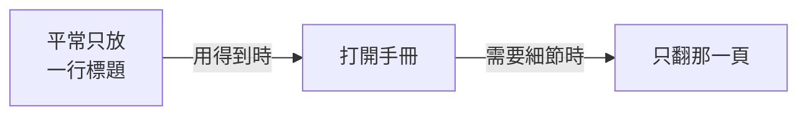

- 整本手冊可以寫得很完整，因為平常**只有標題放在桌上**（03 的工作桌）
- **把手冊拆成小頁**，它就只需要翻用得到的那頁
- 手冊可以請 AI 幫忙寫，但一定要**人審查**：寫錯的手冊，每次都會被照著做

---

## 📄 Skill 長什麼樣子？一份 Markdown

把 04 撞過的坑，寫成 `05-loop-skill/demo/skills/shop.md`：

檔案開頭，兩行描述（實際檔案用兩行 `---` 包起來）：

```markdown
name: shop
description: 修改 shop/ 裡的價格計算前先讀，記錄了這個專案已知的坑
```

接著是內容 `# 迷你商店：已知的坑`，就是一張 Markdown 表格：

| 症狀 | 原因 | 正確做法 |
|---|---|---|
| 金額變成 159.20000000000002 | 用 float 乘折扣 | 用 `Decimal` 計算 |
| 28.5 被算成 28 | Python 的 `round()` 不是四捨五入 | 用 `Decimal` 的 `ROUND_HALF_UP` |
| 測試出現 `KeyError: 'GOLD'` | 收銀機送來的會員代號是**大寫** | 查 `RATES` 前先 `.lower()` |

**不用寫程式**，會寫文件就會寫 skill。

---

## 手冊，送出去長什麼樣子？

和 04 一樣的 System，只在最後**多了一行**：

```
[System]
你是一位工程師，在一個 Python 專案資料夾裡工作，請用繁體中文。
每一輪只能回覆一個 JSON，不要有其他文字。你能用的工具：
- {"tool": "list_files"}　列出專案裡的所有檔案
- {"tool": "read_file", "path": "檔名"}　讀一個檔案
……（write_file、run_tests、done）

團隊手冊（用 read_file 打開）：
- skills/shop.md：修改 shop/ 裡的價格計算前先讀，記錄了這個專案已知的坑
```

- 桌上只多了**一行標題**；手冊內容要它自己按 `read_file` 打開
- 這一行就是從手冊開頭的 `description` 抄過來的

<span>來源：05-loop-skill/demo/runs/ex2_skill/有手冊-1/log.txt</span>

---

## 🔬 實測 ③：把坑寫進手冊之後

`python3 05-loop-skill/demo/ex2_skill.py`：04 的 L2，有手冊、沒手冊各 3 次

| | 3 次的分數 | 打開手冊 | 平均步數 | 平均跑測試 | 平均花費 |
|---|---|---|---|---|---|
| 沒有手冊 | 7, 7, 7 | — | 9 | **2 次** | 0.08 元 |
| **有手冊** | 7, 7, 7 | **3/3** | **8** | **1 次** | 0.06 元 |

- 有手冊的 3 次，都在動手前就打開了 `skills/shop.md`
- 第一次寫就加了 `.lower()`，**跑一次測試就過**，不用再撞一次 `GOLD`
- 花費每次差很多（0.02～0.09 元），**跑測試的次數**比較準

> 📌 坑只要踩一次，寫進手冊，**下次就不用再付一次錢**。

<span>來源：05-loop-skill/demo/traces/ex2_skill.txt；每次的完整對話在 runs/ex2_skill/</span>

---

## ✍️ 練習 6：寫一張「坑表」（8 分鐘）

題目：**新人第一次報帳**。
想想新人（或 AI）最常踩的坑，寫 3 條：

| 症狀（看到什麼問題）| 原因 | 正確做法 |
|---|---|---|
| | | |
| | | |
| | | |

最後，替這張表寫**一行標題**：「什麼情況下要翻開這張表？」

---

## 📝 練習 6 參考答案（範例）

| 症狀 | 原因 | 正確做法 |
|---|---|---|
| 單據被退件：「抬頭不符」| 發票上沒有公司統編 | 消費**當下**就要報公司統編 |
| 系統送不出去 | 超過期限的單據會被鎖住 | 每月固定日期前送出 |
| 主管說看不懂 | 用途只寫「餐費」| 寫清楚「誰、為什麼、哪個專案」|

**一行標題**：「處理報帳、發票、差旅費相關問題時使用」

> 📌 這就是一份 **Skill**：平常只有那**一行標題**放在桌上；遇到報帳時，AI 才翻開這張表。

<span>（以上為示範用的範例，請換成你們公司實際的規定）</span>

---
layout: section
---

# 06　加場快閃：兩張地圖

Embedding、Ontology：🎲 防它猜錯你們的世界

<!-- 選講，約 10 分鐘，只講觀念；時間不夠就跳過 -->

---

## 兩張地圖

| | AI 的地圖（Embedding）| 你的地圖（Ontology）|
|---|---|---|
| 怎麼來的 | 從大量文字學來，**隱含**在模型裡 | 團隊**明確寫下來** |
| 知道什麼 | 一般的意思（**通用**）| **你們公司**的東西、叫法、關係 |
| 用來做什麼 | 用「意思」找資料（RAG）| 對齊概念、約束檢查、幫忙找資料 |

> 📌 AI 知道一般的「會員」是什麼，但不知道**你們的**會員。

---

## AI 的地圖：Embedding 把「意思」變成位置

<div class="grid grid-cols-2 gap-6 items-center">
<div>

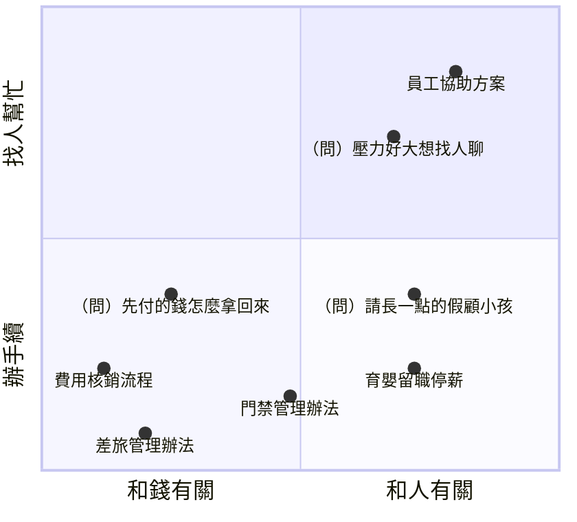

</div>
<div>

每一段文字，都被放到一個**位置**上：**意思近的，放得近**。

- **好處**：問題和文件**一個字都不一樣**，意思近就找得到（連跨語言都行）
- **限制**：地圖是**通用**的：你們內部的叫法、只有名字沒有說明的東西，它放不準

<span>示意圖，不是實際數值；真正的位置有幾百個維度</span>

</div>
</div>

---

## RAG：先找，再答


- 找的方式：**關鍵字**（字一樣才找得到）、**語意**（意思近就找得到）
- 也可以不先找好，讓 AI 帶著工具**自己找**（04）：比較慢、比較貴，但找不到會再找

> 📌 RAG 的上限就是「**找**」：找錯了，AI 也只會在錯的資料上回答。

---

## 你的地圖：Ontology

**有哪些東西、有什麼屬性、彼此什麼關係、有哪些規則**，明確寫下來。用 04 的迷你商店：

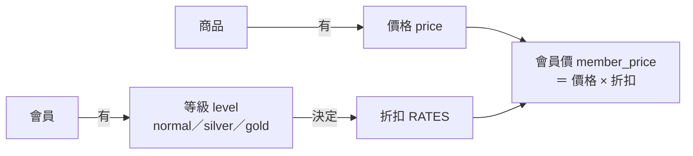

軟體圈相近的說法：**領域模型**、DDD 的「**通用語言**」（Ubiquitous Language）。

---

## Ontology 的三個用法

| 用法 | 做什麼 | 例子 |
|---|---|---|
| ① 對齊概念 | 一個東西只用一個詞；不同的東西不混在一起 | 會員等級就叫 `level`；「客戶」和「會員」是不是同一件事？|
| ② 約束、檢查 | 關係和規則寫成結構，程式可以自動擋 | 退款沒有對應的原訂單 → 擋；折扣寫死 0.8 → 擋 |
| ③ 幫忙找資料 | 同義詞、相關概念，讓搜尋找得到 | 「顧小孩的假」→ 育嬰留職停薪 |

> 📌 名字錯了，只是不好讀；**關係錯了，會變成 bug**。

---

## 一份規格，兩種用法

```toml
[terms.level]
label     = "會員等級"
values    = ["normal", "silver", "gold"]
forbidden = ["tier", "membership", "customer_type"]
source    = "code"     # 從 shop/rates.py 整理

[rules.discount]
rule   = "折扣只能從 RATES 查，不可以寫死數字"
source = "team"        # 團隊決定
```

```mermaid
flowchart LR
    O["這份規格"] -- "寫之前" --> A["當 context 給 AI 看"]
    O -- "寫之後" --> B["程式自動檢查"]
```

- 詞彙從**文件、程式碼、團隊決定**整理，每條寫明來源；文件會過時，不要只抄文件（03）
- **事先告訴，比事後擋下便宜**（05）；檢查還是要有，它是安全網

---

## 兩張地圖，合起來用

```mermaid
flowchart LR
    Q["口語問題<br/>「顧小孩的假」"] --> T["用你的地圖<br/>翻成公司用詞<br/>「育嬰留職停薪」"]
    T --> S["用 AI 的地圖<br/>找最近的文件"]
    S --> A["放上工作桌<br/>AI 回答"]
    A --> C["用你的地圖<br/>檢查用詞、規則"]
```

> 📌 **AI 的地圖負責「意思」，你的地圖負責「你們」。**

---
layout: section
---

# 07　總結

---

## 一路走來：每一層都在防這兩件事

```mermaid
flowchart TB
    G["🎲 猜測<br/>沒說的，它自己決定"] --> P["Prompt<br/>寫出來"]
    G --> C["Context<br/>給對資料<br/>RAG 幫忙找"]
    G --> O["Ontology<br/>你們的概念地圖"]
    S["⚡ 短路<br/>最快不衝突就交差"] --> H["Harness<br/>讓它繞不過去"]
    S --> L["Loop<br/>你來驗收"]
    S --> K["Skill<br/>先標出捷徑上的坑"]
```

**AI 從頭到尾都沒換過。** 變的是我們給它的東西。

---

## 🔬 今天看到的證據

同一顆 AI（haiku 5.5），每次**只改一個地方**：

| 章 | 只改了什麼 | 結果 |
|---|---|---|
| 02 Prompt | 加上「範例」 | 2/7 → **7/7**；再加「驗收」，才**真的能上線** |
| 03 Context | 範本標上「現行」 | 要你確認、扣分 → **直接寫對** |
| 04 Harness | 給它 `run_tests` | 6/7 → **7/7** |
| 05 Loop | 外層驗收 | 6/7 **沒人發現** → 退件一次，**7/7** |
| 05 Skill | 寫一張坑表 | 跑測試 2 次 → **1 次** |

<span>每一個數字，都可以在各章的 demo/ 自己重跑一次；紀錄在各章 demo/traces/</span>

---

## 帶走三句話

1. **🎲 AI 猜得比你想像的多。**
   → 寫清楚、給對資料、寫下你們的概念地圖，要它附上證據。

2. **⚡ AI 會短路：最快、不衝突就交差。它看不到的限制，就不存在。**
   → 把限制寫成程式：工具、門鎖、沙箱、你的驗收。

3. **越早回饋、越早寫下經驗，就越便宜。**
   → 讓它自己測，你負責驗收，踩過的坑寫成手冊。

---
layout: section
---

# Q & A

謝謝大家
